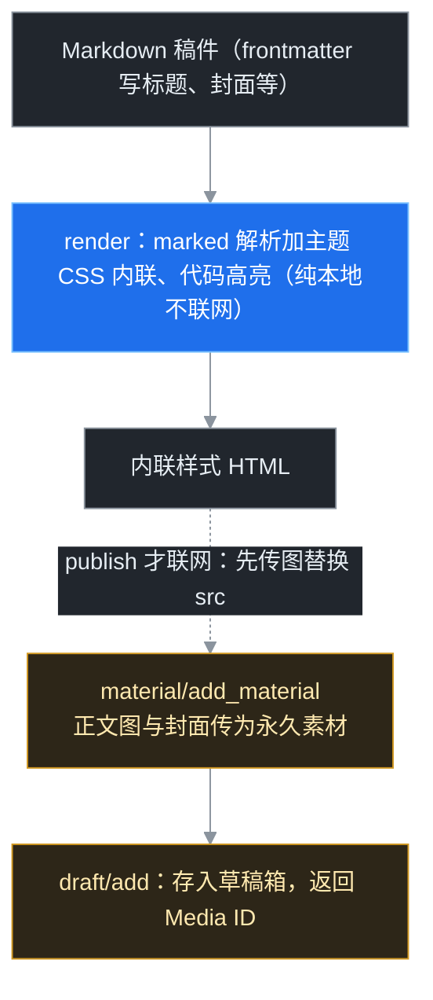
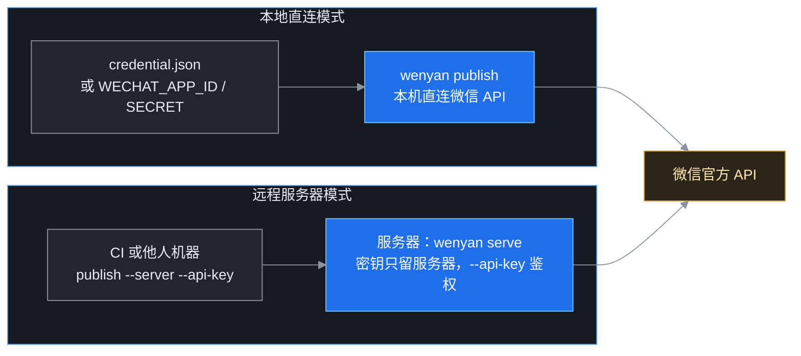

> 文颜（WenYan）是一个把 Markdown 渲染成公众号排版 HTML、并能直接推进公众号草稿箱的命令行工具。这篇文档讲清四件事：**它怎么干活、六个子命令各管什么、稿件要按什么格式写、什么写法会被微信拒收**。读者是协作者与各个 AI 工作窗口，接到「把 Markdown 发公众号 / 排版 / 草稿箱」类任务时，先查这篇。
>
> 配套阅读：[《Markdown 一键同步飞书知识库》](/drafts/2026%E5%B9%B49%E6%9C%8830%E6%97%A5-Markdown%E4%B8%80%E9%94%AE%E5%90%8C%E6%AD%A5%E9%A3%9E%E4%B9%A6%E7%9F%A5%E8%AF%86%E5%BA%93.md)同属「命令行工具箱」系列；自造脚本 `scripts/wechat-draft.mjs` 与文颜的分工见本文第七节。

## 一、它是什么

文颜是开源命令行工具，npm 包名 `@wenyan-md/cli`（当前 2.0.7，命令名 `wenyan`，仓库 caol64/wenyan-cli），渲染核心是随包安装的 `@wenyan-md/core`（3.0.8）。它只干一件事：

**把 Markdown 渲染成公众号编辑器能直接吃的「内联样式 HTML」，需要时再调微信官方接口存进草稿箱。**

公众号图文正文只接受内联样式（class 和外链 CSS 都会被剥掉），所以 Markdown 直贴后台必然乱版。文颜在本地把标题、引用、代码块、表格、脚注、数学公式全部转成带 `style=""` 的 HTML，图片统一传成微信永久素材，最后调 `draft/add` 一步进草稿箱。全程只碰官方接口，且**只进草稿箱，不碰群发**。



跟在公众号后台手动排版相比，它的价值是：纯文本写作、版式样貌由主题统一保证、一条命令复现、能被脚本和 AI 直接调用。

## 二、安装、凭据与第一次自检

### 1. 安装

```bash
npm install -g @wenyan-md/cli
wenyan --version        # 2.0.7
```

包没有声明 Node 版本门槛，本机 Node v24 实测通过，建议用 Node 18 以上。

### 2. IP 白名单是第一道门槛

调微信接口取 access_token 时，请求来源 IP 必须在公众号后台「设置与开发 → 基本配置 → IP 白名单」里。没加白名单会拿到 `40164` 报错。换网络、走代理后发不出去，先怀疑出口 IP 变了。

### 3. 录入凭据

```bash
wenyan credential -s      # 交互式输入 AppID 和 AppSecret（密文输入，不回显）
wenyan credential -l      # 查看凭据文件位置，不打印内容
```

Windows 下凭据存在 `%APPDATA%\wenyan-md\credential.json`（即 `C:\Users\<你>\AppData\Roaming\wenyan-md\`），token 缓存同目录 `token.json`。凭据也可以不录入，改用环境变量 `WECHAT_APP_ID` / `WECHAT_APP_SECRET`，或发布时用 `--env-file` 指定一个 env 文件。

凭据解析优先级（源码 `getAppIdAndSecret`）：

1. 调用方同时显式传入 AppID 与 AppSecret；
2. 环境变量 `WECHAT_APP_ID` / `WECHAT_APP_SECRET`；
3. `credential.json` 中按 AppID 查到的记录；
4. 都没有就报错：「未提供 AppID」。

CLI 的 `publish` 只暴露了 `--app-id`，没有 `--app-secret`，所以日常用法是先 `credential -s` 存好，或用 env 文件。

### 4. token 自检

token 默认由工具自动获取、缓存和刷新，不需要手动管。两个排查用命令：

```bash
wenyan token -l                       # 看 token 缓存位置
wenyan token -i --app-id <AppID> --token <外部token>   # 导入自备 token
```

导入外部 token 后其 `expireAt` 被置为 -1，文颜不再管理它的生命周期，适合用平台自己刷新的长期 token 调试。要恢复自动管理，删掉 `token.json` 即可。

## 三、六个子命令地图

| 子命令 | 干什么 | 联网 |
|-|-|-|
| `render` | Markdown → 排版 HTML，结果打到 stdout | 否，纯本地 |
| `publish` | 渲染 + 传图 + 调 `draft/add` 进草稿箱 | 是 |
| `theme` | 列出、添加、删除排版主题与代码高亮 | 否 |
| `credential` | 交互式录入 AppID/AppSecret，查存储位置 | 否 |
| `token` | 查 token 位置、导入外部 token | 否（导入本身不联网） |
| `serve` | 起一个 HTTP 服务，把渲染和发布能力开放成 API | 发布时联网 |

公共选项（render 与 publish 都有）：

```bash
-f, --file <path>        # 从本地文件或 web URL 读 Markdown；不给则读位置参数（直接贴字符串）
-t, --theme <id>         # 排版主题，默认 default
-h, --highlight <id>     # 代码高亮主题，默认 solarized-light
-c, --custom-theme <css> # 用自己的 CSS 主题文件
--no-mac-style           # 关掉代码块顶部红黄绿三个圆点（默认开）
--no-footnote            # 关掉「链接转文末脚注」（默认开）
```

publish 专属选项：

```bash
--app-id <AppID>         # 指定公众号（secret 走凭据文件或环境变量）
--env-file <file>        # 启动时加载的 env 文件
--proxy <url>            # 代理，如 http://127.0.0.1:1080
--server <url>           # 不直连微信，改调远程发布服务
--api-key <key>          # 远程服务的访问密钥
```

## 四、render：先在本地把 HTML 看透

`render` 不上传任何东西，是发布前最便宜的自查手段：

```bash
wenyan render -f 稿件.md > 稿件.html      # 存文件，用浏览器打开看版
wenyan render -f 稿件.md                  # HTML 直接打在终端
wenyan render -f https://example.com/a.md  # 也能直接吃网页 URL
wenyan render "# 直接传字符串"             # 不给 -f 时第一个参数当 Markdown 正文
```

换主题和高亮：

```bash
wenyan theme -l                  # 列全部主题
wenyan render -f a.md -t pie     # 用 pie 主题
wenyan render -f a.md -h github  # 换代码配色
```

内置八个排版主题：`default`（经典长文）、`orangeheart`（暖橙）、`rainbow`（活泼多色）、`lapis`（冷蓝极简）、`pie`（少数派风格，锐利现代）、`maize`（浅米黄）、`purple`（淡紫）、`phycat`（物理猫薄荷绿）。

`theme --add --name 名字 --path 主题.css` 可以加自己的 CSS 主题，`theme --rm 名字` 删除。

**链接脚注（默认开）要专门说一下**：公众号正文里的外链不可点，文颜的做法是把每个超链接变成正文里的上标编号 `[1]`，文末自动生成「引用链接」清单。注意它**只追加脚注，不删 `<a>` 标签**，原文的链接文字仍是彩色锚文本，这个细节在第七节还会咬人。

## 五、稿件格式：frontmatter 字段约定

文颜用 `front-matter` 库解析开头的 YAML 块，字段决定草稿属性：

| 字段 | 作用 | 去向 |
|-|-|-|
| `title` | 草稿标题 | 草稿标题，**不渲染进正文** |
| `description` | 摘要 | 草稿 digest，同时渲染成正文开头的灰底斜体引用块 |
| `cover` | 封面图，本地路径或图片 URL | 上传为永久素材后绑定封面 |
| `author` | 作者 | 草稿作者字段；不填就是空（不会自动补名） |
| `source_url` | 原文链接 | 草稿的「原文链接」 |
| `need_open_comment` | 是否开评论（0/1） | 草稿属性 |
| `only_fans_can_comment` | 是否仅粉丝可评论（0/1） | 草稿属性 |
| `image_list` | 预声明图片清单 | 一般用不到 |

可直接抄的范例：

```yaml
---
title: 我的文章标题
description: 一两句话摘要，它会同时出现在正文开头
author: 叶扬
cover: ./images/cover.png
need_open_comment: 0
---

正文从这里开始……
```

要意识到三件事：

1. `title` 不会出现在正文里。想要正文大标题，得在正文自己写 `# 标题`，那会被渲染成居中 H1。
2. `description` 一处填写、两处出现：后台摘要里有它，正文最顶上也有它的引用块。不想在正文里看到摘要，就别填这个字段。
3. vault 现有稿件的 frontmatter 是 `title/date/tags/status` 四件套。文颜只挑它认识的字段读，`date/tags/status` 会被忽略、不进正文，所以同一个文件既能放 vault 又能喂文颜，但**文颜需要的封面、作者得另外补**。

正文扩展语法方面：标准 Markdown 之外，代码块走 highlight.js 高亮并默认带 mac 圆点；LaTeX 数学公式由内置的 mathjax 在本地渲染，不依赖外部服务。

## 六、publish：图片、封面与草稿

### 1. 发稿

```bash
wenyan publish -f 稿件.md --app-id <你的AppID>
# 成功输出：发布成功，Media ID: <草稿的 media_id>
```

工具按顺序做三件事：取 token；把正文 HTML 里的每张图取来传到 `material/add_material`（type=image），用返回的素材地址替换 `src`；最后调 `draft/add`。

### 2. 图片机制的几个事实

- **全部走永久素材接口**，不用正文图临时接口。支持 bmp/png/jpeg/jpg/gif，单张上限 10MB，本地相对路径和网络 URL 都能取。
- **去重只在一次运行内有效**：进程里维护一张映射表，同一次 publish 中重复出现的图片只传一次；但进程退出映射就没了，下次发同一篇稿会重新上传、在素材库里占新名额。永久图片素材有 5000 个上限，反复调试发稿要留意素材库膨胀，失败重跑也可能留下无人引用的孤儿封面，定期去后台素材管理清理。
- **封面的选取规则**：frontmatter 写了 `cover` 就用它（文件名固定按 cover.jpg 上传）；没写就取正文第一张图当封面；一张图都没有且没封面，仍可建草稿，只是没有封面。

### 3. 两种部署形态



`wenyan serve -p 3000 --api-key <密钥>` 在一台已加 IP 白名单、存好凭据的机器上起服务，别的机器（或 CI）用 `publish --server http://服务器:3000 --api-key <密钥>` 把渲染和发布委托过去。这样 AppSecret 不用散落到每台干活的机器上。注意 serve **必须加 `--api-key`**，裸奔等于把发稿能力开放给整个网络。

## 七、能力边界：发布前必查的一个硬坑

下面这一条 2026 年 10 月在本机用真实稿件实测，踩中就是**整篇发不出去**。

### 站内相对链接原样进正文，publish 必撞 45166

微信 `draft/add` 校验正文时，只接受 `http(s)`、`mailto` 等白名单协议的链接。Markdown 里写 `[返回地图](/drafts/博客地图.md)` 或 `[某节](#section)`，文颜**不做协议净化**，原样产出 `<a href="/drafts/...">`，提交即返回 `45166 invalid content`。

实测确认：默认开启的脚注功能只会在链接后面加上标、在文末补清单，`<a>` 标签原样保留；加 `--no-footnote` 也只是没了脚注，锚标签还在，救不了。唯一的规避是**发布前自己净化稿件**：

- 外链统一写全 `https://`；
- 站内导航、相对路径、页内锚点，发布版本里改成纯文字或直接删掉；
- 不确定时先 `render > out.html`，搜一遍 `href="` 看有没有非 http 协议。

### 与自造脚本 `scripts/wechat-draft.mjs` 的分工

| 维度 | 文颜 CLI | wechat-draft.mjs（自造） |
|-|-|-|
| 排版 | 八套主题、代码高亮、公式支持 | 单一固定内联样式 |
| 图片 | 全走永久素材，单次运行内去重 | 首图双传，无去重 |
| 相对链接 | 不处理，发存量旧稿必撞 45166 | 自动剥非白名单链接标签留文字 |
| 适合 | 语法标准、从零按文颜约定写的新稿 | vault 存量稿、尾部带站内导航链接的稿 |

结论：新稿按文颜约定写，用文颜；把 vault 里已经成型、尾部带着站内导航的旧稿直接推草稿箱，继续用自造脚本。

## 八、实战：从渲染到进草稿箱的完整序列

```bash
# 1. 确认凭据与网络
wenyan credential -l                      # 凭据文件在不在
# 若没配过：wenyan credential -s

# 2. 本地排版自查（不联网、不传图）
wenyan render -f 稿件.md -t pie > out.html
#    浏览器打开 out.html：看主题与排版，搜 href=" 排查相对链接

# 3. 推进草稿箱（只进草稿箱，绝不群发）
wenyan publish -f 稿件.md --app-id wxXXXXXXXXXX
#    发布成功，Media ID: xxxxxxxxxxxxxxxx

# 4. 去公众号后台「草稿箱」手机预览，肉眼验收后再决定群发
```

带 env 文件、不污染全局凭据的写法：

```bash
wenyan publish -f 稿件.md --env-file ./.env.local
# env 文件内：WECHAT_APP_ID=... / WECHAT_APP_SECRET=...
```

## 九、踩坑记录

| # | 现象 | 原因 | 解决 |
|-|-|-|-|
| 1 | 取 token 报错 40164 | 出口 IP 不在白名单 | 后台加 IP；换网/代理后先查出口 IP |
| 2 | publish 报 45166 invalid content | 正文有相对/锚点链接 | 净化为 http(s) 或剥成纯文字 |
| 3 | 以为加 --no-footnote 能治 45166 | 脚注不删 a 标签 | 没用，仍需净化链接 |
| 4 | 发成功但后台找不到封面 | 没写 cover，正文也没图 | frontmatter 补 cover |
| 5 | 作者是空的 | author 不填不补默认值 | frontmatter 写 author |
| 6 | 素材库越攒越多 | 去重仅单次运行内有效，重跑即重传 | 定期清孤儿素材，调试用 render 不用 publish |
| 7 | serve 起在局域网谁都能发 | 没加鉴权 | 必须 `--api-key`，有条件加防火墙白名单 |

## 十、安全边界

> - AppSecret 只通过 `credential -s` 交互录入或 env 文件提供，**不入 git、不进聊天记录、不贴截图**；凭据文件与 token.json 都在用户配置目录，不放在项目同步目录里。
> - 工具只有「进草稿箱」能力，没有群发入口；任何流程都不要绕过「后台人工手机预览」这一步。
> - `serve` 远程模式必须带 `--api-key`，服务器自己持有凭据，调用方只拿 api-key；api-key 泄露等于发稿权泄露。
> - 排版与公式都在本地完成，不依赖第三方排版服务；但正文图片会上传到微信永久素材库，未公开的配图先想清楚再 publish。
> - 失败重跑后去素材库核对孤儿图片；公众号素材是账号资产，不留垃圾。
