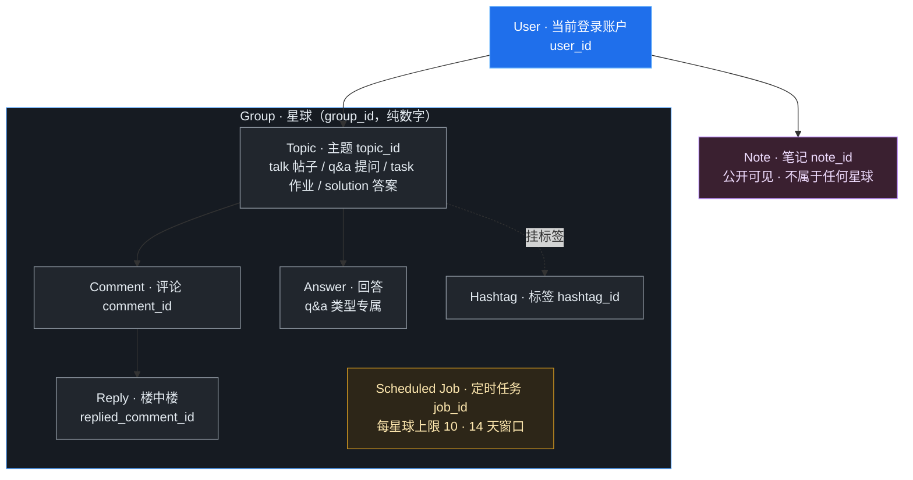
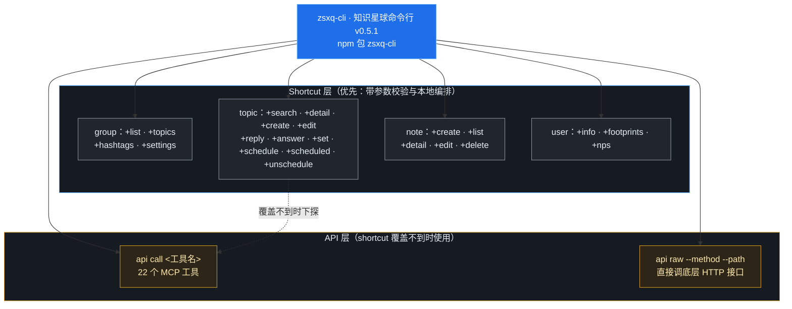

> zsxq-cli 是知识星球（zsxq，旧称小密圈）的命令行工具。和以只读为主的 breakout CLI 不同，**它是一个全功能读写工具**：发帖、评论、回答提问、定时发布、设精华置顶、打标签、查成员、写笔记，甚至发起微信支付都能做。这篇文档讲清它的能力结构、常用命令、运营场景和必须守住的边界。
> 
> 配套阅读：[《破局官网命令行 breakout CLI 使用指南》](https://ccn0rxnhnvug.feishu.cn/wiki/V2HzwQTkEiEmz9kKQuAcZDswnFe)、[《飞书多维表格实战：CLI 读写、幂等同步与三范式拆表复盘》](https://ccn0rxnhnvug.feishu.cn/wiki/Lb57wYmrUi1gsPkdwqHcOWr2n1d)、[《别怕命令行：AI 是怎么帮你“动手”的？》](https://ccn0rxnhnvug.feishu.cn/wiki/CzZhwCNosiZE8Lk7PyKc4jkKn0g)。

## 一、它是什么，处在什么位置

知识星球是 AI 破局内容的**真正源头**：帖子、组局最先发在星球，破局官网（aipoju.com）再从星球**每小时同步**一次。因此：

- 要查官网近一小时内还没同步的新内容，直接查星球；
- 要**发帖、评论、运营整个社群**，用 zsxq-cli；官网 breakout CLI 不提供这些写能力；
- 它是 npm 包（包名 `zsxq-cli`，当前 0.5.1），用本人星球账号登录工作。

## 二、核心概念与资源层级



```
subgraph SG["Group · 星球（group_id，纯数字）"]
    direction TB
    T["Topic · 主题 topic_id&lt;br/>talk 帖子 / q&amp;a 提问 / task 作业 / solution 答案"]
    C["Comment · 评论 comment_id"]
    RP["Reply · 楼中楼&lt;br/>replied_comment_id"]
    AN["Answer · 回答&lt;br/>q&amp;a 类型专属"]
    HT["Hashtag · 标签 hashtag_id"]
    SJ["Scheduled Job · 定时任务 job_id&lt;br/>每星球上限 10 · 14 天窗口"]
    T --> C
    C --> RP
    T --> AN
    T -. "挂标签" .-> HT
end

N["Note · 笔记 note_id&lt;br/>公开可见 · 不属于任何星球"]

U --> T
U --> N

style U fill:#1f6feb,stroke:#79c0ff,color:#ffffff
style SG fill:#161b22,stroke:#58a6ff,color:#e6edf3
style T fill:#21262d,stroke:#8b949e,color:#e6edf3
style C fill:#21262d,stroke:#8b949e,color:#e6edf3
style RP fill:#21262d,stroke:#8b949e,color:#e6edf3
style AN fill:#21262d,stroke:#8b949e,color:#e6edf3
style HT fill:#21262d,stroke:#8b949e,color:#e6edf3
style SJ fill:#2d2618,stroke:#d29922,color:#ffe9b0
style N fill:#3a2030,stroke:#bc8cff,color:#f0ddff
```

| 资源 | 标识 | 说明 |
|-|-|-|
| User 用户 | user_id | 当前登录账户 |
| Group 星球 | group_id（纯数字） | 社群单元，成员或星主 |
| Topic 主题 | topic_id | talk 帖子 / q&a 提问 / task 作业 / solution 答案 |
| Comment 评论 | comment_id | 主题下回复；楼中楼用 replied_comment_id |
| Scheduled Job 定时任务 | job_id | 定时发帖或回答；每星球上限 10、14 天窗口 |
| Note 笔记 | note_id | **公开可见**，持链接即可访问，不属于任何星球 |

## 三、安装、登录与自检

```bash
npm install -g zsxq-cli          # 安装；可与 @larksuite/cli 一起装
zsxq-cli auth login             # 登录（浏览器/凭证认证）
zsxq-cli auth status            # 查看当前登录身份
zsxq-cli doctor                 # 检查配置与认证健康，出问题先跑
zsxq-cli config show            # 版本与登录信息
```

默认假设已安装已登录，不必每次先检查；只有命令报认证或 HTTP 错误时，再按错误提示处理。

## 四、双通道：先 shortcut，不够再下探 API



```
subgraph SC["Shortcut 层（优先：带参数校验与本地编排）"]
    direction TB
    G1["group：+list · +topics&lt;br/>+hashtags · +settings"]
    T1["topic：+search · +detail · +create · +edit&lt;br/>+reply · +answer · +set · +schedule · +scheduled · +unschedule"]
    N1["note：+create · +list&lt;br/>+detail · +edit · +delete"]
    U1["user：+info · +footprints · +nps"]
end

subgraph AP["API 层（shortcut 覆盖不到时使用）"]
    direction TB
    AC["api call &amp;lt;工具名&amp;gt;&lt;br/>22 个 MCP 工具"]
    AR["api raw --method --path&lt;br/>直接调底层 HTTP 接口"]
end

CLI --> G1
CLI --> T1
CLI --> N1
CLI --> U1
CLI --> AC
CLI --> AR
T1 -. "覆盖不到时下探" .-> AC

style CLI fill:#1f6feb,stroke:#79c0ff,color:#ffffff
style SC fill:#161b22,stroke:#58a6ff,color:#e6edf3
style AP fill:#161b22,stroke:#d29922,color:#e6edf3
style G1 fill:#21262d,stroke:#8b949e,color:#e6edf3
style T1 fill:#21262d,stroke:#8b949e,color:#e6edf3
style N1 fill:#21262d,stroke:#8b949e,color:#e6edf3
style U1 fill:#21262d,stroke:#8b949e,color:#e6edf3
style AC fill:#2d2618,stroke:#d29922,color:#ffe9b0
style AR fill:#2d2618,stroke:#d29922,color:#ffe9b0
```

能力分两层，优先用上层：

1. **Shortcut 层**：`group/topic/note/user` 下的 `+命令`，带参数校验和本地编排，行为最可控；
2. **API 层**：`api call <工具名>`（22 个 MCP 工具）或 `api raw --method --path`（直接调 `/v2/`、`/v3/` 底层 HTTP），只在 shortcut 覆盖不到时用。

> 💡 `api raw` 不是“法外通道”：它同样受安全规则约束，写入仍须用户确认；且不能臆造未文档化的 method/path。拿不准有哪些接口时先看 CLI 帮助与 `api list`。

## 五、常用命令

### 1. group：星球与内容浏览

```bash
zsxq-cli group +list --json                 # 我加入/创建的星球，拿 group_id
zsxq-cli group +list --scope all --limit 200 --json
zsxq-cli group +topics --group-id &lt;id&gt; --json   # 星球最新主题（分页）
zsxq-cli group +hashtags --group-id &lt;id&gt; --json # 标签及各标签主题数
```

### 2. topic：发帖、搜索、互动（核心模块）

| 需求 | 命令 |
|-|-|
| 全文搜索 | `zsxq-cli topic +search --group-id <id> --query <词> --json` |
| 帖子详情 | `zsxq-cli topic +detail --topic-id <id> --json` |
| 发帖 | `zsxq-cli topic +create --group-id <id> --text <正文> [--markdown / --markdown-file a.md]` |
| 向某人提问（q&a） | `topic +create --group-id <id> --ask <对方user_id> --text <问题> [--anonymous]` |
| 发投票 | `topic +create --group-id <id> --text <正文> --vote-title <标题> --vote-options 选项一,选项二` |
| 评论 / 楼中楼 | `topic +reply --topic-id <id> --text <内容> [--reply-to <comment_id>]` |
| 回答提问 |  |
| 编辑自己的帖子 | `topic +edit`（正文、附件、投票等） |
| 精华 / 置顶 | `topic +set`（需星主或管理员权限） |
| 定时发布 / 查看 / 取消 | `topic +schedule` / `+scheduled` / `+unschedule` |

带图片或文件用 `--files 路径`（逗号分隔）；AI 生成内容可加 `--ai` 或用 `--ai-mode aigc|personal_perspective|none` 作声明。

### 3. note 与 user

```bash
zsxq-cli note +create --text &lt;内容&gt; [--files a.jpg,b.jpg]  # 笔记仅支持文本和图片
zsxq-cli note +list --json
zsxq-cli user +info --json            # 自己的资料（不含手机号）
zsxq-cli user +footprints --json      # 跨星球发帖足迹，一次查全
zsxq-cli user +nps                    # 提交 NPS 反馈
```

### 4. api：成员、专栏与任意底层调用

```bash
<code"># 成员列表（raw；expired_time 仅付费星球星主/管理员可见）<br/>zsxq-cli api raw --method GET --path /v2/groups/&lt;group_id&gt;/members --query '{"limit":20}'<br/># 专栏列表 / 创建专栏<br/>zsxq-cli api raw --method GET  --path /v2/groups/&lt;group_id&gt;/columns<br/>zsxq-cli api raw --method POST --path /v2/groups/&lt;group_id&gt;/columns --body '{"name":"专栏名"}'<br/># 调用封装好的 MCP 工具<br/>zsxq-cli api call set_topic_digested --topic-id &lt;id&gt; --digested true
```

## 六、运营场景：把原子操作编排成业务流程

skill 内置了一批场景，每个由多个原子命令按流程编排。有对应需求时直接按场景做：

| 场景 | 做什么 |
|-|-|
| 每日巡场 | 汇总今天需要关注和处理的新内容 |
| 评论区运营 | 找出未回复评论、起草回复 |
| 提问管理 | 整理别人向我提、尚未回答的问题并排优先级 |
| 精华与标签整理 | 判断哪些帖子加精、打什么标签 |
| 运营日报 / 周报 / 复盘 | 按周期汇总运营数据成报告 |
| 日报海报 / 竖版视频 | 把星球内容生成 PNG 海报或 MP4 动画 |
| 负面内容监控 | 巡查辱骂、广告、投诉等风险内容 |
| 批量打标签 | 按给定标签批量回标主题 |
| 到期成员续费关怀 | 识别即将到期成员、按活跃度分层写话术 |
| 收录主题到专栏 | 把最新主题批量归档进专题专栏 |

## 七、Skill Pay 与微信支付（高敏区）

> 💳 - 付费加入、续费、买礼品卡/轻读、付费提问、赞赏等，走 Skill Pay，**仅在支持 WorkBuddy 且宿主提供官方微信支付能力时可用**；不满足须在下单前说明并停止；
> - 下单前必须先查或算出价格，确认类型、对象与实付金额；固定价格不接受用户改写；
> - **支付必须由用户本人授权**。返回待支付（PAYMENT_REQUIRED）不代表失败也不代表已付，禁止自动重复下单。

## 八、能力边界与易踩点

- **笔记是公开的**，任何拿到链接的人都能看；隐私、敏感信息绝不写进笔记；
- **定时任务有限额**：每星球 10 个、只能定 14 天内；
- **成员搜索 ≠ 成员列表**：`search_group_members` 是按昵称关键词找人，别调大 limit 当全员名单遍历；
- **设置专栏归属是全量替换**：“加进一个专栏”要先读现有集合、并入后再整体回设，否则会覆盖掉原有归属；
- 精华、置顶、改星球资料等需相应管理权限，低权限账号操作会被拒；
- 星球产品规则类问题（退款、费率、开票、封禁等）应查官方帮助中心 doc.zsxq.com 后回答，不凭印象编。

## 九、安全边界

> 💡 - 绝不输出或传播认证 token，不分享给他人；
> - 一切写入与删除（发帖、编辑、评论、回答、定时、精华置顶、改资料、建/删笔记、取消任务、NPS）执行前必须确认用户意图；
> - 不确定 group_id / topic_id / comment_id / note_id 时先查询核对，再动手；
> - 示例中的 ID、订单号均为模拟值，实际操作必须用查询到的真实标识；
> - 支付由本人授权；他人信息只用于任务本身，不批量归集、不外传。
