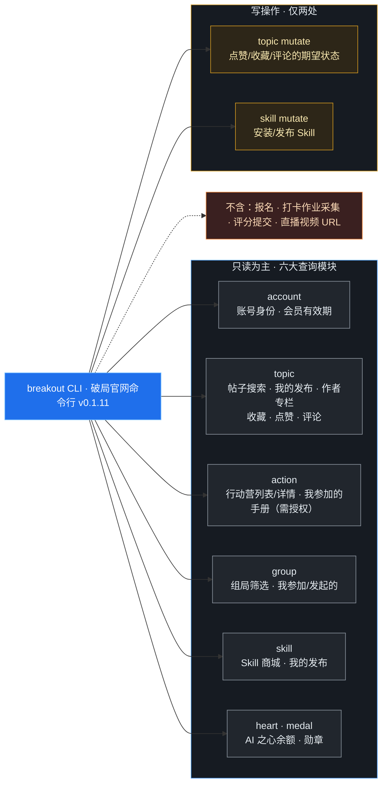
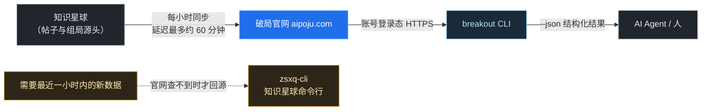

> breakout CLI 是 AI 破局俱乐部官网（aipoju.com）的官方命令行工具。这篇文档讲清三件事：**它能查到哪些官网数据、每个需求该用哪条命令、哪些事它明确做不了**。读者是协作者与各个 AI 工作窗口，接到「破局官网 / 帖子 / 行动营 / 组局」类任务时，先查这篇，别重复造轮子，也别去硬试它不开放的能力。
> 
> 配套阅读：[《飞书多维表格实战：CLI 读写、幂等同步与「手册视频总表」三范式拆表复盘》](https://ccn0rxnhnvug.feishu.cn/wiki/Lb57wYmrUi1gsPkdwqHcOWr2n1d)（breakout 在实战中的完整案例）、[《命令行里的飞书：认识飞书 CLI 与飞书 Skill》](https://ccn0rxnhnvug.feishu.cn/wiki/NodXwvNgTiimlYkDW56cmwwinAc)、[《别怕命令行：AI 是怎么帮你“动手”的？》](https://ccn0rxnhnvug.feishu.cn/wiki/CzZhwCNosiZE8Lk7PyKc4jkKn0g)。

## 一、它是什么

breakout CLI 是一个**独立二进制程序**（不是 npm 包，当前版本 0.1.11，命令名 `breakout`），安装后用你本人的官网登录态工作。它把官网开放的能力整理成固定子命令，加 `--json` 就返回机器可读的结构化结果，方便脚本和 AI 直接使用。

当前账号共开放 **13 项能力**（随时可用 `breakout capabilities --json` 查看最新清单），归到 7 个命令模块，其中绝大多数是只读查询：



| 能力 id | 性质 | 含义 |
|-|-|-|
| account.query | 只读 | 账号身份与会员有效期 |
| topic.query / topic.mutate | 读 / 写 | 官网帖子查询；点赞、收藏、评论等状态操作 |
| action.query | 只读 | 破局行动与行动营（手册需另行授权） |
| group.query | 只读 | 组局查询与筛选 |
| skill_store.query / skill_store.mutate | 读 / 写 | Skill 商城查询；安装与发布 Skill |
| ai_heart.query | 只读 | AI 之心余额、明细、排行与统计 |
| medal.query | 只读 | 勋章目录与统计 |
| topic_review.\*（4 项） | 只读 | 精华评审身份、待评审池、评审历史与评分共识 |

## 二、登录、自检与限流

| 命令 | 用途 |
|-|-|
| `breakout auth login` | 登录官网；未认证时一切查询都会提示先登录 |
| `breakout doctor` | 一键检查登录态、网络、后端能力与本机配置，出问题先跑它 |
| `breakout account show --json` | 查看当前身份、会员到期时间与角色标签 |
| `breakout update` | 检查并升级独立安装的 CLI 本体 |
| `breakout capabilities --json` | 查看当前账号实际可用的能力与开关状态 |

> ⏳ **限流是自动处理的：**服务端要求等待时，CLI 会按给出的等待时间自动重试，单次请求最多重试 2 次、累计等待不超过 65 秒，可用 Ctrl+C 取消；超限后返回具体等待秒数，不会无限重试。这意味着我们自己写脚本时**不需要**再加复杂退避，礼貌限速即可。

## 三、常用命令地图

下面按模块列出固定命令。**优先用这些固定命令**，不要一上来就用 `call` 或 `query` 拼原始调用；固定命令覆盖不到时再查 `breakout <模块> --help`。

### 1. account：账号与身份

```bash
breakout account show --json          # 身份、会员有效期、角色标签
breakout person resolve 洋哥 --json   # 解析内置人物别名（见第五节）
```

### 2. topic：官网帖子（命令最全的模块）

| 需求 | 命令 |
|-|-|
| 近期帖子 / 关键词搜索 | `breakout topic list --page 1 --size 20 [--keyword 词] --json` |
| 我发布的帖子 | `breakout topic mine --page 1 --size 20 --json` |
| 某作者的帖子 | `breakout topic author --user-number <编号> --page 1 --size 20 --json`（知道编号优先用编号；--nickname 是精确匹配） |
| 我的收藏 / 收藏历史 | `breakout topic collections`（只含仍在收藏的）/ `breakout topic collection-history` |
| 点赞、收藏（期望状态，幂等） | `breakout topic like <topicId>` / `unlike` / `collect` / `uncollect` |
| 评论与回复 | `breakout topic comments <topicId>`、`breakout topic comment <topicId> --content <内容>`、`breakout topic replies <commentId>` |

### 3. action：破局行动与行动营

| 需求 | 命令 |
|-|-|
| 近期可用行动营（含详情页链接） | `breakout action list --page 1 --size 20 --json` |
| 行动营列表 / 详情（兼容命令） | `breakout action camps`、`breakout action camp <ID>` |
| 我参加过的行动营 | `breakout action mine --page 1 --size 20 --json` |
| 行动手册 / 预习手册 | `breakout action manual <行动营ID>` / `breakout action preview-manual <ID>`（默认关闭，见第五节） |

### 4. group：组局

```bash
# 公共组局筛选：省市、状态、类型、关键词各归各位
breakout group list --city 北京 --status 报名中 --page 1 --size 20 --json
breakout group joined --page 1 --size 20 --json   # 我参加过的组局
breakout group mine   --page 1 --size 20 --json   # 我发起的组局
```

注意 `--keyword` 只搜标题和组织者昵称，**地点必须用 `--city/--province/--district`**，不能塞进关键词。

### 5. skill / heart / medal

```bash
breakout skill submissions --page 1 --size 20 --json  # 我发布的 Skill
breakout heart balance --json                        # AI 之心余额
breakout heart <明细/排行/统计子命令> --json
breakout medal list --page 1 --size 20 --json        # 勋章
breakout medal stats --json
```

> 📝 **固定字段名别自创翻译：**AI 之心余额三字段固定为 `heart`=AI 之心、`heartChip`=心片、`heartLite`=晶体；不要写成“心力值”之类。另外，对外统一称**行动营**（用户口中的“训练营”是它的旧称别名），但命令里的 `camp/camps` 保持原样不动。

## 四、返回结果怎么读

- **统一加 `--json`**。返回中的 `_context.websiteUrl` 若存在，最终答复要保留成可点击的 Markdown 链接（记录级 URL 链接到对应标题）；没返回 URL 时不要自己编路由。
- **时间字段**：`createdAt`、`updatedAt`、`*Time` 等是 Unix 毫秒的 UTC 时刻；CLI 同时给出 `*Shanghai` 字段（如 `expireTimeShanghai`），直接用它，按上海时间显示，别再加 8 小时。
- **两类 ID 别混用**：帖子详情、点赞、收藏、评论用帖子列表返回的数字 `topicId`；`id` 是本地 UUID，不用于这些操作。
- **错误输出**：成功 JSON 走 stdout，错误 JSON 走 stderr；脚本解析时 stdout 为空要回退看 stderr。

**内置人物身份：**`洋哥`、`findyi`、`易洋` 是同一个人的别名，正名“洋哥”，知识星球用户编号 `1`，AI 破局俱乐部创始人。查其帖子优先用编号 1，可用 `breakout person resolve <别名> --json` 验证，不要当成三个人。

## 五、能力边界（最容易踩的一节）

### 1. 数据时效与回源



官网帖子由知识星球**每小时同步**一次，官网结果可能比源头晚约 60 分钟。只有当官网缺这个能力、查不到结果，或用户明确要最近一小时内的源数据时，才回源用 zsxq-cli（知识星球命令行），并说明可能的同步延迟。

### 2. 手册操作有双重门槛

- **行动手册**：默认关闭。先跑 `breakout capabilities --json` 确认 `action.query` 下挂出了 `camp_manual`，再用 `breakout action manual <ID>`；且账号必须通过行动、身份、报名或服务角色校验（简单说，多数情况下**报名了该期**才取得到）。
- **预习手册**：独立开关，从报名开始到开营前、对身份可见账号开放，**不需要报名**；正式手册的权限不代表有预习权限。
- 取不到手册时不要用别人身份、不要绕开关，也不要拿正式手册冒充预习手册。

### 3. 明确不开放的能力

> 🚧 - **没有**行动营/组局的报名入口，也**没有**打卡作业采集和评分提交（志愿者评分走 Playwright 版 scraper.py / submit_rating.py）；
> - **不返回直播回放视频 URL**。需要视频链接时，走官网前端接口（登录页内 fetch），完整复盘见[《飞书多维表格实战》](https://ccn0rxnhnvug.feishu.cn/wiki/Lb57wYmrUi1gsPkdwqHcOWr2n1d)，那次共取到 1066 条；
> - AI 之心仅开放余额、明细、排行、统计，不提供分红状态与结算；勋章只读；
> - 不暴露被禁用、已删除或对当前账号不可见的记录。

## 六、实战示例：拉全量行动营清单

「手册视频总表」的第一步就是用 breakout 拿到全部行动营期次。翻页拉全量、保存为 JSON：

```bash
# 近期可用行动营，逐条带详情页链接；逐页翻完
breakout action list --page 1 --size 20 --json > output/_p1.json
# 兼容命令 camps 也可用于全量列表
breakout action camps --json > output/_camps.json
```

实测共 **204 个期次**（2023:8 / 2024:57 / 2025:89 / 2026:50）。关键字段：`id`（campId）、`actionId`（17 个产品族通道，不是期次）、`title`、`campStartTimeShanghai`、`websiteUrl`。后续如何用官网接口补齐手册与 1066 条视频、建成三范式多维表，见配套的[多维表实战文档](https://ccn0rxnhnvug.feishu.cn/wiki/Lb57wYmrUi1gsPkdwqHcOWr2n1d)。

## 七、给 AI Agent 的三种接法

| 接法 | 命令 / 做法 | 适用 |
|-|-|-|
| 直接调用 | Agent 按 Skill 路由直接执行 `breakout ...` | 最常用，本机已登录即可 |
| integrate | `breakout integrate codex`，导出 SKILL.md 到 `~/.codex/skills/breakout-official-cli/` | 给 Codex；官方仅支持 codex 目标 |
| MCP | `breakout mcp`，把官网能力作为 MCP 服务提供 | 支持 MCP 的通用 Agent |

本机的多 Agent 共享做法：导出的 skill 正本放在 `~/.agents/skills/breakout-official-cli/`，用 Windows 目录联接（junction）挂到各 Agent 的 skills 目录，改一处处处生效。这属于本机运维细节，了解即可。

## 八、踩坑记录

| # | 问题 | 原因 | 解决 |
|-|-|-|-|
| 1 | 手册取不回来 | 开关默认关闭 + 需报名 | 先 capabilities 确认，再查报名身份 |
| 2 | 以为 breakout 能给视频 URL | 该能力未开放 | 走官网前端接口（见多维表文档） |
| 3 | 用 id(UUID) 操作点赞报错 | 写操作要数字 topicId | 用列表返回的 topicId |
| 4 | 时间显示差 8 小时 | 把毫秒 UTC 又加了一次 8 小时 | 直接用 \*Shanghai 字段 |
| 5 | 组局按城市搜不到 | 城市塞进了 --keyword | 地点用 --city，keyword 只搜标题 |
| 6 | 脚本里 stdout 解析为空 | 错误信息走 stderr | stdout 空时回退解析 stderr |
| 7 | 把洋哥/findyi 当两个人 | 不了解内置别名 | 同一人，编号 1，person resolve 验证 |

## 九、安全边界

> 💡 - 只读请求用最小匹配命令；写请求（mutate）先看 capabilities，选最窄操作，高影响或不可逆动作须经人确认；
> - 绝不读取或泄露登录 token；不使用他人身份、不绕过已禁用的操作；
> - 官网报名类请求只返回详情页链接，由人在详情页继续，不构造直达报名路由；
> - 查询结果中的他人信息只用于任务本身，不外传、不批量归集个人数据。
