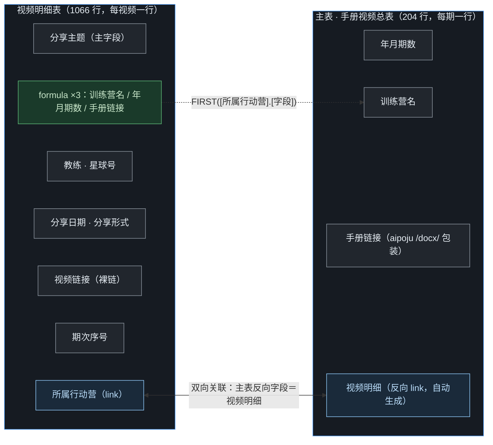
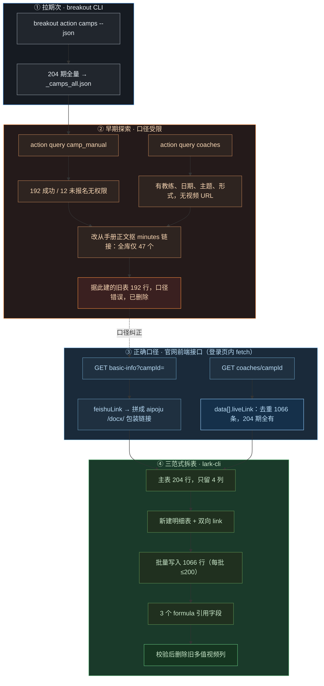

> 这篇文档一身二任：**① 造表复盘**：完整交代飞书多维表格「手册视频总表」是怎么从 0 做出来的，包括一个被纠正过的错误口径；**② 通用教程**：如何用飞书命令行 lark-cli 定位、读取、写入、幂等同步任意一张多维表格。
> 
> 为什么要写复盘：把视频下载归档到 B 站是**另一个 AI 工作窗口**执行的，它读到的是这张表的现状，并不知道数据口径与建表过程。把来历写清楚，各窗口与后续协作者才能对齐，重跑新月份时不会再用错口径。
> 
> 配套阅读：[《破局行动视频：从飞书妙记下载到发布 B 站 · 全流程工作流》](https://ccn0rxnhnvug.feishu.cn/docx/CGJydSUGioC6vtxfu7ccZEO8nrb)（操作手册）、[《破局视频归档实战复盘》](https://ccn0rxnhnvug.feishu.cn/docx/IPoPdFYTuor8aQxKRptcBXsLnVm)（B 站侧踩坑）、[《命令行里的飞书：认识飞书 CLI 与飞书 Skill》](https://ccn0rxnhnvug.feishu.cn/wiki/NodXwvNgTiimlYkDW56cmwwinAc)（零基础入门篇）。

> 📌 **先记住最关键的一条口径：**表里 1066 条视频链接，全部来自破局官网前端接口 `GET /server/camp-manage/coaches/<campId>` 返回的 `liveLink` 字段。它**不是** breakout CLI 提供的（该 CLI 不返回视频 URL），也**不是**从手册正文里抠的（那样全库只有 47 个）。

## 一、先对齐：这张表是什么

「手册视频总表」位于飞书知识库「破局行动」，是 AI 破局各期行动营的手册与教练直播回放的总索引。访问入口与关键标识：

| 项 | 值 |
|-|-|
| 知识库链接 | [wiki/PJADwL0aciLSdNkZoHnciiuQntb](https://ccn0rxnhnvug.feishu.cn/wiki/PJADwL0aciLSdNkZoHnciiuQntb) |
| space_id（破局行动） | `7690880204561976504` |
| base app_token | `LmGwbzofwavErRs8oaCcCvMGnAe` |
| 主表 table_id | `tbl2K1tkni7YeO3o`（204 行，每期一行） |
| 视频明细表 table_id | `tblDHXaLMsZhqwD2`（1066 行，每视频一行） |

### 1. 两表关系



两表通过**双向关联**连接：明细表的「所属行动营」指向主表，主表自动生成反向字段「视频明细」。明细表另有 3 个 formula 字段，沿关联引用主表的训练营名、年月期数、手册链接，不重复存数据。

### 2. 主表字段（拆表后仅 4 列）

| 字段 | 类型 | 含义 |
|-|-|-|
| 年月期数 | text | 如 2026-09 |
| 训练营名 | text | 期次标题 |
| 手册链接 | text(url) | aipoju /docx/ 包装链接，点进去是破局壳页内嵌签名 iframe |
| 视频明细 | link（反向） | 自动汇总该期所有视频行 |

### 3. 视频明细表字段（11 项）

| 字段 | 类型 | 含义 |
|-|-|-|
| 分享主题 | text（主字段） | 视频标题；为空时用教练名兜底 |
| 所属行动营 | link | 双向关联到主表 |
| 教练 | text | 分享人 fullName |
| 星球号 | text | userNumber |
| 分享日期 | datetime | 按月筛选的依据；无源数据时留空 |
| 分享形式 | text | shareType，如飞书妙记、直播回放、小鹅通直播 |
| 视频链接 | text(url) | 裸链，已去查询参数 |
| 期次序号 | number | sortOrder，期内分享顺序 |
| 训练营名 / 年月期数 / 手册链接 | formula ×3 | FIRST([所属行动营].[对应字段])，沿关联引用主表 |

### 4. 关键数字（从源数据实测，非估算）

| 指标 | 数值 | 说明 |
|-|-|-|
| 行动营期次 | 204 | 2023:8 / 2024:57 / 2025:89 / 2026:50 |
| 视频总数（去重） | 1066 | 175 个期次有视频，29 个无视频 |
| 有 / 无精确日期 | 904 / 162 | 无源日期的含 39 条仅提供到年月 |
| 飞书妙记 d16rg8unadx 子域 | 894 | 绝大多数视频 |
| 小鹅通 | 170 | swnvq / zg371.xetslk.com 等域名 |
| 飞书妙记 vcnkc8uq9kjy 子域 | 2 | 另一妙记租户 |

数据血缘一句话：**breakout CLI 给出 204 个期次清单 → 官网前端接口给出手册包装链接与 1066 条视频 liveLink → lark-cli 建表写入并维持两表关联**。

## 二、造表全过程复盘



### （一）第一步：用 breakout CLI 拉到期次清单

breakout CLI（命令名 `breakout`，`breakout-cli` 为同名兼容命令，v0.1.11）是破局官网的只读命令行工具。列出行动营：

```bash
# 兼容命令 camps：行动营列表；逐页翻全量
breakout action camps --json
# 新版等价写法（近期可用行动营，逐条带详情页链接）
breakout action list --page 1 --size 20 --json
```

全量翻页后得到 **204 个期次**，手动导出为 `output/_camps_all.json`，后续所有脚本都以它为期次总表。每条记录的关键字段：`id`（campId，期次唯一 ID）、`actionId`（17 个产品族通道之一，注意它不是期次）、`title`、`campStartTimeShanghai`、`websiteUrl`。

### （二）第二步：早期探索，口径受限

最早尝试用 breakout CLI 的只读查询直接取手册与视频，遇到两个硬边界：

```bash
# 行动手册：操作默认关闭，且账号必须已报名该期
breakout action query camp_manual --input-file <campId.json> --json
# 教练分享：只给教练、日期、主题、形式
breakout action query coaches --input-file <campId.json> --json
```

- **camp_manual**：192 期成功，12 期因未报名返回 `status=10010`（PERMISSION_DENIED），无法取全。
- **coaches**：能拿到教练、日期、主题、形式，但**没有直播回放 URL**。

于是退而求其次，用正则从 192 期手册正文里抠飞书妙记链接，结果**全库只有 47 个**，大量教练分享根本没有在手册正文里贴链接。按这个口径建的旧表（192 行）确认是错误口径，**已删除**。

> 💡 **breakout CLI 的能力边界（别再重复试）：**只读查询破局官网，覆盖主题、行动营、组局、勋章等；**不开放打卡作业采集、评分提交，也不返回直播视频 URL**。要视频链接，走官网前端接口。
> **zsxq-cli（知识星球 CLI）本流程未使用。**破局官网数据虽由知识星球小时级同步而来，但本场景的期次、接口都在官网域内，不需要回源星球。

### （三）第三步：正确口径（官网前端接口）

2026-09-29 澄清后改用两个**官网前端接口**。关键优势：在登录页面内直接 fetch，**不要求逐期报名，204 期全部有数据**。脚本用 Playwright 启动无头 Edge，恢复登录态后在页面上下文里执行 `fetch(url, {credentials:'include'})`，自动带 cookie；遇 401/403 则等 token 续期后重试一次。

| 接口 | 取到什么 |
|-|-|
| `GET /server/camp-manage/basic-info?campId=<id>` | `data.feishuLink`：裸飞书 docx |
| `GET /server/camp-manage/coaches/<id>` | `data[]`：每条分享的 fullName / userNumber / shareDate / shareTopic / shareType / liveLink / sortOrder |

**手册链接的处理：**接口给的是裸飞书地址，但我们要的是破局包装链接，抠出 docToken，拼成 `https://aipoju.com/docx/<campId>/<docToken>`。

**视频链接的清洗规则：**只取 `liveLink` 非空；去掉 `?from` 等查询参数；同期按去参数后的 URL 去重。域名与形式实测分布：

| 域名 / 形式 | 数量 | 形式分布（shareType） |
|-|-|-|
| 飞书妙记（两个子域合计 896） | 896 | 飞书妙记 620 · 直播回放 240 · 直播 74 等 |
| 小鹅通 | 170 | 小鹅通直播 52 · 小鹅通 48 · 其余复用妙记口径 |

对应脚本：`fetch_official_links.py`（手册包装链接 + 视频初采）、`fetch_video_details.py`（补全星球号、分享形式、期次序号，输出 `_video_details.json`）。两者都按每期落盘、限速 2–3.5 秒加随机抖动，中断后重跑自动续做。

### （四）第四步：三范式拆表

**旧结构的问题：**视频链接最初塞在主表的一个单元格里、用换行分隔多个值，违反第一范式，也无法承载每个视频自己的教练、日期、形式等属性。

**拆表设计：**

1. 主表只保留 4 列，删除原多值「视频链接」列；
2. 新建视频明细表，每视频一行，以双向 link 挂回主表（主表反向字段名「视频明细」）；
3. 重新拉取主表 ndjson，以「年月期数 + 训练营名」组合映射主表 record_id，该组合 204/204 唯一，全部匹配；
4. 用 `build_video_table.py` 批量写入 1066 行：payload 写临时文件、`--json @文件` 提交，每批 ≤200；
5. 追加 3 个 formula 字段引用主表；
6. 全部数据校验通过后，最后才删除旧多值列（不可逆结构改动放最后）。

> 💡 **跨表引用为什么用 formula 而不是 lookup：**lookup 的匹配靠源表主字段文本，主字段若有近似重复会让一条记录匹配到多条；formula 沿 link 按 record_id 真实关联、无歧义，写法 `FIRST([所属行动营].[训练营名])`。

最终核对：明细表 1066 行、175 个期次有视频，主表反向字段各期计数与明细一致，零遗漏。

## 三、通用操作：用 lark-cli 读取多维表格

lark-cli 全程用**本人身份**调用，命令显式加 `--as user`。读取是安全的，但仍建议只取需要的字段，避免大表数据淹没上下文。

### 1. 定位一张表

```bash
# 关键词搜索文档 / wiki
lark-cli docs +search --query "破局行动"
# 取节点详情，拿到 space_id 等信息（URL 或 token 均可）
lark-cli wiki +node-get --node-token "<wiki 链接或 node_token>"
# 列出某知识库空间下所有根节点；--page-all 自动翻页
lark-cli wiki +node-list --space-id "<space_id>" --page-all
# 重要：has_child=true 的节点必须展开子节点，否则会漏内容
lark-cli wiki +node-list --space-id "<space_id>" --parent-node-token "<父节点 token>"
```

### 2. 从链接识别各类 token

| token | 出现位置 | 示例形态 |
|-|-|-|
| node_token | wiki 链接的路径段 | /wiki/PJADwL0...（20+ 位混合字符） |
| app_token（base token） | 多维表 URL 的 base 段 | /base/LmGwbz...，与 wiki 的 obj_token 相同 |
| table_id | 多维表 URL 的 table 参数 | ?table=tbl2K1tkni7YeO3o |

### 3. 看清表结构

```bash
# 一个 base 里有哪些数据表
lark-cli base +table-list --base-token "<app_token>"
# 一张表的字段清单（字段名、类型、field_id）
lark-cli base +field-list --base-token "<app_token>" --table-id "<table_id>"
```

### 4. 读取记录并导出文件

```bash
lark-cli base +record-list \
  --base-token "<app_token>" --table-id "<table_id>" \
  --field-id 视频链接 --field-id 分享日期 --field-id 分享主题 \
  --format ndjson --limit 2000 --output ./_records.ndjson
```

- **格式选择**：`--format ndjson` 每行一条记录；json 格式单次 limit 上限 200，ndjson 可放到 2000，大表一次拉完。
- **只取需要的列**：用多个 `--field-id`（传字段名或 field_id）限定。
- **端上过滤**：`--jq` 后接表达式，只保留关心的字段或记录。

### 5. 读回值的渲染规律（解析 ndjson 时务必知道）

| 字段类型 | 读回形态 | 例 |
|-|-|-|
| text | 字符串原样 | 胡星火 |
| number | 原生数字（非字符串） | 3 |
| select | 数组，元素为选项名 | ['否'] |
| datetime | ISO 8601 带时区 | 2026-09-24T00:00:00.000+08:00 |
| text(url) | Markdown 链接，勿用宽泛正则吞行 | [[https://x]](https://x) |

每条记录还带一个 `record_id` 键（形如 `reczz28...`），更新和关联时要用它，别拿主字段当 ID。校验链接是否写对，最稳的是断言「写入的 URL 是读回原文的子串」，不要用 `[^)]` 类正则。

## 四、通用操作：写入与批量更新

写操作在命令帮助里标为 **write**，删表删字段等标为 **high-risk-write**。两个习惯：写之前先 `--dry-run` 预览请求；高风险操作显式加 `--yes`。

### 1. 批量新建

```bash
# payload 文件 _create.json：
# { "create_records": [ {"分享主题":"...", "教练":"..."}, {...} ] }
lark-cli base +record-batch-create \
  --base-token "<app_token>" --table-id "<table_id>" \
  --json "@D:/绝对路径/_create.json"
```

### 2. 批量更新

```bash
# payload 文件 _update.json（注意：key 是 record_id，结构与新建不同）：
# { "update_records": { "recXXXX": {"作业点评":"..."}, "recYYYY": {...} } }
lark-cli base +record-batch-update \
  --base-token "<app_token>" --table-id "<table_id>" \
  --json "@D:/绝对路径/_update.json"
```

### 3. 字段值类型对照（写入时按目标列类型传值）

| 目标列类型 | 传值方式 | 注意 |
|-|-|-|
| text | 字符串直传 | 空值省略该字段 |
| number | 原生数字，不是 "3" | 字符串数字需先 int() |
| select | 选项名字符串 | 选项须已存在 |
| datetime | "2026-09-24 00:00:00" | 纯日期会报 800010403；批内原子，一条错整批拒 |
| url | 裸字符串 | 不用包成 markdown |
| link | [{"id": "<目标 record_id>"}] | link 列不能由其他类型转换，须直接以 link 类型建 |

- 每批最多 **200 条**；大 payload 一律写文件走 `--json @绝对路径`（路径用正斜杠），别往命令行里硬塞。
- 批次是原子的，建议批间停顿 2–3 秒，既保护接口也便于定位失败批次。

## 五、幂等 upsert：让同步可以反复重跑

批量写入最常见的坑是「重跑一遍 → 数据翻倍」。解法是选一个**业务主键**，先拉远端做 diff，按三种结果分别处理：

1. 本地有、远端没有 → 放进 `create_records` 新建；
2. 两边都有、但关键内容（如点评正文）不同 → 按 record_id 放进 `update_records`；
3. 两边一致 → 跳过。

```python
def diff(local_rows, remote):
    creates, updates = [], {}
    for r in local_rows:
        k = r["业务主键"]
        if k not in remote:
            creates.append(to_fields(r))
        elif r["关键内容"] != remote[k]["关键内容"]:
            updates[remote[k]["record_id"]] = to_fields(r)
    return creates, updates
```

真实实例是仓库根的 `feishu_sync.py`：读本地 `output/作业质量跟踪.csv`，以「作业键」（星球编号_日期_HHMMSS）为幂等主键同步到飞书多维表「作业质量跟踪」，并设了时间范围（只推 2026-09-01 之后）。它已接进 `submit_rating.py`，每天提交成功后自动同步；环境变量 `SYNC_FEISHU=0` 可关闭，同步失败只告警、不阻塞提交。

## 六、日常运维：教练分享的增量同步

造表是一次性的，维护是长期的：行动营在进行中会陆续补排教练分享，官网 coaches 接口对老营期也会返回新条目。早期的 `fetch_video_details.py` 以「done 即跳过」续跑，抓完一遍后就发现不了这些新增，需要专门的增量流程。它由仓库根的两个脚本完成：

| 脚本 | 职责 |
|-|-|
| `refresh_recent_coaches.py` | 强制重拉近期营期（ym ≥ 2026-08）的 coaches，done 也刷，就地更新 `_video_details.json`，打印每期新增与消失的 URL |
| `sync_video_increment.py` | 拉飞书两表 ndjson，以「裸 URL 是否已存在于视频链接字段」为判据，把新视频 `record-batch-create` 进明细表 |

三个关键口径：

1. **只刷近期营期**：仅 ym ≥ 2026-08 的营期可能补排分享（首次执行时 11 个期次），一次刷完；更老的营期不必重复请求。
2. **增量判据用 URL 成员判断**：明细表读回的「视频链接」是 `[u](u)` markdown，收集其中 http token 组成集合，新 URL 不在集合内才写入；不用模糊匹配，避免错写重份。
3. **关联仍走主表映射**：沿用「年月期数＋训练营名」→ 主表 record_id 的映射，新记录的「所属行动营」挂真实 record_id，与建表时口径一致。

> ✅ **首次执行结果（2026-10-05）：**刷 11 个近期营期，发现并写入 6 条 2026-09-29 的教练分享（均为 d16rg8unadx 妙记），明细表 **1066 → 1072 行**，二次拉取核对无误。脚本可反复重跑，无新增时零写入。注：前文及第一节中的 1066 为 2026-09-30 建表当日数字。

## 七、日常运维（二）：新增妙记下载并 append 归档到 B 站

上一节的增量同步只解决了「新视频进飞书表」；这些新分享还要按 9 月建立的归档口径补到 B 站，但不是新建合集，而是 **append 到各训练营已存在的私密稿件**。整体四段：**生成分批清单 → 下载妙记 → 逐条 append → 核验后删除本地**。

### 1. 生成分批清单

`output/_make_batches.py` 内置本次新增 URL、训练营→BV 映射与分 P 标题覆盖表，一次产出：

| 产物 | 内容 |
|-|-|
| `_batch1/2/3.json` | 每批 4/4/3 条，即 minutes_downloader 的输入格式 |
| `_batch_manifest.json` | 每条 `{batch, bv, part_title, local_name, url}`，append 编排依据 |

两个关键口径：

- **训练营 → BV** 用 9 月已建的私密合集：一个训练营一个 BV，新分享就是给它加分 P；
- **分 P 标题**统一 `yyyyMMdd-topic@coach-star`，写在覆盖表里，与下载器命名规范一致。

### 2. 分批下载

```bash
python ../video/minutes_downloader.py --input output/_batch1.json --limit 4
python ../video/minutes_downloader.py --input output/_batch2.json --limit 4
python ../video/minutes_downloader.py --input output/_batch3.json --limit 3
```

长视频走 m3u8（某条 2314 个分片，解析约 440 秒）。`minutes_downloader.py` 的 `M3U8_PREPARE_MAX` 已从 300 提到 **1200**，否则解析没完就被判超时。

### 3. 逐条 append

`output/_append_driver.py` 读 manifest，按 `@coach-star` 尾段在下载目录唯一定位文件，再执行 append：

```bash
# 用法: python _append_driver.py <批次> <序号> [submit接口]
python output/_append_driver.py 1 1 web
python output/_append_driver.py 2 2 app
```

其拼出的实际命令：

```bash
python -m biliup -u cookies.json append --vid <BV> \
  --is-only-self 1 --copyright 2 \
  --source "AI破局俱乐部教练分享，志愿者内部备份" \
  --submit web <视频文件>
```

四个必须记住的口径：

1. **分 P 标题取上传文件名（去扩展名），`--title` 不生效**，标题要靠下载时的文件命名保证，不必像 9 月那样建硬链接暂存；
2. **`--is-only-self 1`**：追加的分 P 同样仅自己可见，目标稿件本身是 state=-50 的私密稿；
3. **append 用 copyright=2 并填 source**（与 9 月建合集时的 copyright=3 不同，转载口径按接口要求补来源）；
4. **`--submit` 的 app / web 换着用**：默认通道失败或被限（code 21566）时，换一条通道通常立即放行，两边独立计数。

### 4. 核验并清理

```bash
python -m biliup -u cookies.json show <BV>
```

核对分 P 数与标题无误后，删除 `video/videos` 里对应的本地文件，不留大体积副本；`_batch_manifest.json` 保留作为归档台账。

> ✅ **执行结果（2026-10-08）：**上一节增量发现的 11 条妙记分 3 批全部完成「下载 → append → 核验 → 清理」，共补入 7 个私密稿件：GEO获客 4P、AI超级大脑 4P、AI全域系统带货 6P、AI小红书虚拟产品 5P、Agent Skills锤炼营 4P、FDE初探营 5P、Workbuddy铸造营 6P，全部仅自己可见、无水印。

## 八、Windows 环境的四个坑

| 坑 | 现象 | 处理 |
|-|-|-|
| 调用 .cmd 失败 | 直接 CreateProcess 报 WinError 2 | subprocess 加 shell=True，路径用 shutil.which("lark-cli.cmd") |
| 命令行长度限制 | 约 5.5KB 起被截断，理论上限 8191 | payload 写临时文件，--json @正斜杠绝对路径 |
| 中文输出乱码 | UTF-8 解码失败、stdout 变 None | bytes 捕获，先 utf-8 再 gbk 依次 decode |
| node_token 手抄出错 | 报 131013 token invalid | 直接复制 node-list 原文；或用 obj_token 反查权威 node_token |

## 九、踩坑记录汇总

| # | 问题 | 原因 | 解决 |
|-|-|-|-|
| 1 | 手册 12 期取不到 | camp_manual 需逐期报名 | 改走官网前端接口，不限报名 |
| 2 | 视频链接只找到 47 个 | 手册正文大多没贴链接 | 取官网 coaches 的 liveLink |
| 3 | 旧表 192 行口径错误 | 数据源本身不全 | 删表重建为三范式结构 |
| 4 | 写入 datetime 整批被拒 | 纯日期不合规（800010403） | 补全为 YYYY-MM-DD HH:mm:ss |
| 5 | 重跑后记录翻倍 | 没有幂等比对 | 按业务主键 diff 后再写 |
| 6 | lookup 字段串值 | 按主字段文本匹配有歧义 | 改用 formula FIRST 关联引用 |
| 7 | 大 payload 命令被截断 | cmd.exe 命令行长度上限 | --json @文件，每批 ≤200 |
| 8 | 列 wiki 节点漏内容 | 没展开 has_child 子节点 | 加 --parent-node-token 展开 |
| 9 | token 报 131013 invalid | 手抄错一个字符 | 以 node-list 原文复制为准 |

## 十、命令模板速查

```bash
# === 定位 ===
lark-cli docs +search --query "<关键词>"
lark-cli wiki +node-list --space-id "<space_id>" --page-all
lark-cli wiki +node-list --space-id "<space_id>" --parent-node-token "<父节点>"

# === 看结构 ===
lark-cli base +table-list --base-token "<app_token>"
lark-cli base +field-list --base-token "<app_token>" --table-id "<table_id>"

# === 读 ===
lark-cli base +record-list --base-token "<app_token>" --table-id "<table_id>" \
  --format ndjson --limit 2000 --output ./_records.ndjson

# === 写（先 --dry-run 预览） ===
lark-cli base +record-batch-create --base-token "<app_token>" --table-id "<table_id>" \
  --json "@D:/path/_create.json"
lark-cli base +record-batch-update --base-token "<app_token>" --table-id "<table_id>" \
  --json "@D:/path/_update.json"
```

```bash
# === 教练分享增量同步（日常运维） ===
python refresh_recent_coaches.py
python sync_video_increment.py

# === 新增妙记 append 归档 B 站（详见第七章） ===
python output/_make_batches.py
python ../video/minutes_downloader.py --input output/_batch1.json --limit 4
python output/_append_driver.py 1 1 web        # 参数: 批次 序号 app|web
python -m biliup -u cookies.json show <BV>     # 核验分 P 后删除本地文件
```

## 十一、安全边界

> 💡 - 真实网站与飞书的写操作必须由人明确触发，AI 不自行提交、不推送远程；
> - high-risk-write（删表、删字段、删节点）须核对目标、显式加 --yes；不可逆结构改动放在数据校验通过之后；
> - 全程慢速礼貌限速，批次间停顿；拉取只取必要字段；
> - 学员花名册等含手机号、微信的敏感数据（business/）不入表、不提交、不外传。
