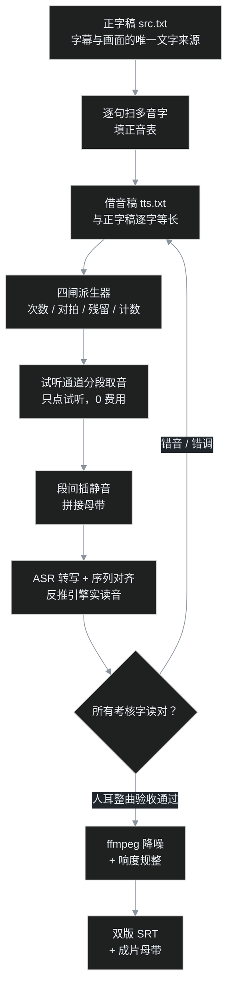

## 先交底

叶扬最近做完一个听上去有点「硬核」的活：用自己的克隆音色，让 TTS 完整念完了不空译本《楞严咒》——**3601 个汉字，成片 16 分 57 秒**，字音经逐字校对、人耳整曲验收通过，最后还做了降噪和响度规整，直接能挂进视频当主音轨。

TTS 念几个字谁都会，念 17 分钟、每个字都要念对，就是另一回事了。佛经咒文是多音字雷区加梵音专名的混合体——「南无」不能念 nán wú，「修行」不能念 xiū háng，「薄伽梵」的「薄」要念 bó，引擎却默认 báo；还有一批传承读音连正字都不写那个音，得靠「借字」骗引擎。整曲靠人肉听 17 分钟找错音，听完耳朵也废了，还必然漏。

最后跑通的是一条**全自动质检兜底、人耳只做裁定**的流水线。这篇把整条工艺摊开，下次不管是念咒、念长文稿还是做有声书，照着搭就能复用：

```
正字稿 → 借音稿（四闸派生）→ 试听通道分段取音 → 拼接
      → ASR 自动校对反推实读 → 错音回改重取 → 人耳验收
      → ffmpeg 降噪 + 响度规整 → 双版字幕 + 母带
```

## 全流程长什么样



这套流程的核心思想，用程序员的话说：**TTS 引擎是个黑盒 API，输入文本、输出声波，没有任何音素级日志**。那就别猜，像调试任何黑盒一样——构造输入、抓输出、写断言、回归测试。ASR 就是这个黑盒的「反编译工具」：让引擎念完，再让语音识别把声波翻译回汉字，两边一对，哪里念错了自动现形。

## 第一步：双稿体制——一份给人看，一份给引擎念

整个工艺的地基是两份**逐字等长**的稿子：

- **正字稿 src.txt**：正常文字，「南无阿弥陀佛」「修行」「薄伽梵」。这是字幕、视频画面、给读者看的唯一文字来源。
- **借音稿 tts.txt**：专门写给 TTS 引擎看的发音稿，「南模阿弥陀佛」「修形」——用同音确定字替换多音字，长度一个字不多一个字不少。

为什么必须等长？因为这两份稿子之后要做**逐字索引对齐**：借音稿第 k 个字对应正字稿第 k 个字，字幕时间戳、画面高亮全都靠这个一一对应关系迁移。一旦长度错位，整条索引链全乱。所以借音稿绝不能用「多加一个字解释读音」的办法改音，只能**等长替换**。

借音稿不是手写的——手写 3601 字的替换迟早翻车。正字稿配一份规则表（哪个词换成什么、为什么换、预期出现几次），由派生脚本机械生成借音稿，生成时过**四道闸**：

| 闸 | 拦住什么事故 |
|---|---|
| 次数闸 | 每条替换规则在正字稿里的实际出现次数，必须等于预设值。改稿时增删了字，立刻暴露 |
| 对拍闸（主闸） | 借音稿反序还原后必须与正字稿**逐字相等**，不等就报出第一个错位 |
| 残留闸 | 借音稿里不得残留半角数字、连字符、蛇形命名、`true/false` 这类引擎会瞎念的东西 |
| 计数闸 | 多音字在借音稿里的总次数必须精确等于预期，防止替换漏网或误伤 |

这套闸是一次真实事故的遗产——早期曾经有 8 处未知污染串进句子。这跟写代码一个道理：凡是手滑过一次的地方，就把它变成 CI 里的一条断言，下次别想再溜过去。

**治音优先级：换说法 > 借音。** 写正字稿阶段就能避的坑，别留到借音。比如口播稿里「执行」引擎固定念错，就改成「运行」；「行数」改「句数」。消灭问题永远比给问题打补丁可靠。

## 第二步：借音手法库——跟引擎斗智斗勇的实战案例

多音字只是入门。真正有意思的是引擎的各种「执念」，叶扬在这个项目里攒下一组手法：

**① 多音字，借同音的单音字锁死。**「薄」有 báo/bó/bò 三个读音，上下文经常带跑偏；干脆借一个只有 bó 一个读音的「博」。「薄伽梵」在借音稿里写成「博茄饭」，三个读音不稳定的字一次性全锁——「伽」顺带换成引擎稳定读 qié 的「茄」，「梵」换成「饭」（引擎念 fán 二声，借饭钉死 fàn 四声）。

**② 引擎连正字的标准读音都不认，就反查全字库找替身。** 「舍俱尼」的「舍」要读 shě 三声，但引擎死活念 shè 四声；换异体字「捨」，还是 shè。最后把整个 Unicode 汉字库按读音反查一遍，发现 shě 三声可用的字只剩几个生僻面孔，其中一个是日文异体字**「舎」（U+820E）**——引擎一见这个字形，果然老老实实念了三声。

同理「更」要念 gèng 四声，引擎念 gēng；连「亘」（gèn，韵母都不对）都试过，最终全字库里翻出生僻字「堩」（U+5829）拿下。

**③ 用标点破词，强制逐字断读。** 引擎喜欢把相邻字按常见词带跑，就插逗号把词拆碎：想让一个字按字面单念，写成「得，到」。字母缩写更典型，`WCAG` 会被当一个英文词乱拼，写成 `W。C。A。G。` 强制逐字母念——这是六种写法全部失败后的唯一解。

**④ 数字一律写汉字，符号口语化。** 「0.31 秒」写成「零点三一秒」，「第 3 帧」写成「第三帧」，`--shot` 写成「横杠横杠 shot」。半角数字进了残留闸会直接报错。

找替身字时 pypinyin 是必备工具（按拼音反查字库），但要注意它给生僻字的注音也会错——「舎」它就注 shè，跟引擎实际读音不一致。**借音字的实际读音永远以实测为准，词典注音只能当候选名单。**

## 第三步：取音——只用试听通道，分段串行

取音平台用的是蝉镜，叶扬克隆的音色在平台上有两个通道：付费「立即生成」，和网页上的「试听」。试听返回的 wav 与付费生成同源，而试听不收费。自动化脚本严格只做一件事：开浏览器、贴稿、**点试听**、抓音频地址下载——绝不碰生成按钮。这是整条工艺里最硬的红线，脚本里压根没有生成接口的调用路径。

长文本不能一次塞进去。3601 字按语义切成 **9 段**（经题偈颂、各会咒语、回向偈，每段 55 到 169 秒不等），串行取音，段间插入数字静音再拼接：

- 普通章节之间留 0.6 到 0.7 秒；
- 同一段语义连续的两部分之间只留 0.2 秒（续接感）；
- 末段不加尾静音。

插数字静音还有个意外好处：**段间停顿是纯零样本，完全没有底噪**——这一点后来成了降噪诊断的重要参照。

续跑八段大约花了十几分钟。自动化铁律：任何一段返回错误码或缺文件，**立即停止、不自动重试**。错误码先查含义（比如 10201 是登录态过期，重新登录即可），绝不允许脚本自己狂点重试——试听通道虽免费，疯狂重发请求没有任何好处。

## 第四步：ASR 质检——让语音识别当测试工程师

这是整条流水线里技术含量最高、也最值得复用的一环。

### 为什么 ASR 能反推 TTS 读错了音

思路：把拼好的母带喂给 **faster-whisper**（本地离线跑，base 模型 + CPU + int8 量化，不用联网、不花钱），让它把语音转成带时间戳的汉字。然后把 ASR 汉字序列和借音稿做序列对齐。

关键洞察在这：如果 TTS 把某个字念错了，ASR 听到错误读音，就会**写成另一个同音字**。比如借音稿上是「饭」，TTS 念成了二声 fán，ASR 就可能写回「凡」。所以校对不是「看 ASR 写得对不对」，而是——

> **看 ASR 在每个考核字的位置，写成了什么字、那个字读什么音，反推 TTS 实际发出的读音。**

### 序列对齐：Needleman-Wunsch 打分

ASR 会漏字、会多脑补字，两个序列长度不等，不能逐位硬比。用生物信息学里经典的 **Needleman-Wunsch** 序列比对（就是 DNA 碱基配对那个算法），打分规则按汉语发音设计：

- 字形相同：+3 分；
- 拼音相同（不含声调）：+2；
- 声母韵母都同：+2；
- 只韵母同：+1；
- 不匹配：-2，留空（gap）：-1。

这样即使 ASR 写的是白字，只要读音对，依然能正确对上位置。最终定版母带的对齐结果：**3601 字命中 3571，GAP（漏识）仅 30 个，命中率 99%**。

### 踩过的三个坑

**坑一：声调判定不可信，ASR 只用来抓声韵错误。** whisper base 对声调的判断经常飘，二声三声分不清是家常便饭。所以自动流程只断言声母韵母，声调问题统一列出来交给人耳，别让机器替你判调。

**坑二：多音字假阳性——ASR 写回本字时，字典注音骗了你。** 借音稿上写的是「佛」，ASR 也写了「佛」，自动流程拿 pypinyin 一注音，fú（仿佛的读音），和期望的 fó 不符，报 24 处错——全是假警。教训：**ASR 写回本字时无法反推读音**（你不知道它按哪个音识别的），这类必须单列为「字同」交人耳，不参与自动判音。修完这个 bug，报告才从「满屏错字」变得可信。

**坑三：拼音库的调号格式。** pypinyin 带调输出给的是调号（qié）不是数字调（qie2），剥声调的工具函数如果只去数字，qié 和 qiě 永远不等，又一批假错。调号转换用库自带的 `to_normal` / `to_tone3`，别自己写正则。

### 人耳仍然是最后一关，但工作量被压到最小

ASR 把 3601 字缩成一张「重点考核表」：哪些字、在第几秒、ASR 听成了什么。叶扬只需要按表跳转着听，确认机器拿不准的条目。比如「乾闼婆」的「乾」，ASR 一度报 gān，查汉典、核传承注音都是 qián——是 ASR 自己脑补了「干」的简体，销案。最终二轮改音八类（阿、第、饭、博、波、舎、堩、绝），全部走完「改借音稿 → 四闸 → 只重取受影响段 → ASR 复验」的回归循环。

这就是测试金字塔在音频领域的样子：自动测试挡住 95%，人肉只做最终验收。

## 第五步：顺手生成双版字幕

借音稿和正字稿等长，字幕天然能出两版：

- **借音版 SRT**：叶扬自己 PotPlayer 跟听校对用，引擎念什么字就显示什么字，听音定位零障碍；
- **正字版 SRT**：给最终观众的版本。

字幕时间戳直接取 ASR 的词级时间，按句读行聚合成 576 条，句末留 0.8 秒尾巴。又踩一个坑：whisper 遇到它听不清的段落会「丢转」，后面一串句子被压进同一秒，字幕闪切。修法是检测相邻字幕间隔是否低于「每字最少 0.22 秒」，把拥挤区间用前后时间锚点按字数线性重排——挤堆问题零复发。

## 第六步：ffmpeg 降噪——先诊断，再下药，宁轻勿重

TTS 音频有没有底噪？有。神经 TTS 的声码器会留一层稳态宽带本底噪，克隆音色尤其明显，这是生成痕迹，不是故障。但「沙沙声」能不能去、怎么去，得先量，不能上来就套降噪滤镜——**降噪这味药，吃过量比有病更伤身子**。

### 诊断三件套

ffmpeg 自带三件诊断工具，全免费：

- `silencedetect`：找静音段。测出段间 0.7 秒停顿确实是零样本，段内自然停顿的底噪在 -40dB 上下；
- `astats`：量 RMS/峰值。对同一段停顿窗量能量，降噪有没有效果看数字不看感觉；
- `showspectrumpic`：出语谱图。一看全明白了——这条音频最大的污染根本不是高频沙沙，而是 **100–400Hz 一片低频隆隆**（语谱图上的红带），8kHz 以上反而干净得很。

### 反直觉的实测：最流行的滤镜，效果最差

先抽两段各 30 秒（汉文段 + 咒语段）做 A/B 小样，试了三档：

| 处理 | 停顿窗 RMS | 听感/语谱图 |
|---|---|---|
| 原始 | -42.3 dB | 基准 |
| afftdn 轻档（nr=10） | **-38.0 dB，反而升高 4dB** | 语谱图出现 1.6k/3.2k/4.8k 水平条纹 |
| afftdn 中档（nr=20） | -38.0 dB | 条纹更明显 |
| anlmdn 非局部均值降噪 | -44.4 dB，真降 2dB | 无条纹，擦音完好 |
| 只切 95Hz 高通 | -45.1 dB | 低频隆隆免费消失 |

这里的坑叫**音乐噪声（musical noise）**：FFT 类降噪把连续的宽带噪床压成一条条孤立的水平频率线，听感从「沙沙」变成「嗡嗡」的金属感——能量反而更集中，所以 RMS 数字升高。咒语里「瑟、色、悉、沙」这类擦音和嘶声本底处在同一频段，降噪过猛，第一个受伤的就是咒音的清晰度。

有意思的是结局：仪器指标上 anlmdn 完胜，但叶扬把几版小样塞进播放器人耳 A/B，**最终选了指标最差的 afftdn 中档——因为听感上「最清晰」**。语谱图上的条纹客观存在，可在真实重放设备上被音乐掩蔽，人耳反而买账。这提醒很实在：仪器负责排除坏方案，最终拍板的永远是耳朵；工具给证据，品味给决定。

最终全片处理链（一条命令）：

```
highpass=f=65,
afftdn=nr=20:nt=w:nf=-40,
lowpass=f=11000,
loudnorm=I=-16:TP=-1.5:LRA=11
```

末端的 `loudnorm` 是响度规整，目标 -16 LUFS（视频平台的通用响度，B站、YouTube 都不会再二次压低音量），真峰值 -1.5 dBTP 防削波。**推荐两遍法**：第一遍只测量（输出到 null，拿到全片 Integrated/TP/LRA 实测值），第二遍带上测量值做线性归一。本项目实测从 -21.1 LUFS 提到 -16.0，动态范围 2.0 LU 原样保留——等于只拧音量、不压动态。

降噪阶段的三条纪律：

1. **只在母带级处理一次**，不要每个剪辑环节都降一遍，每过一次都伤一次音；
2. **成片另存新文件，定版母带永不覆盖**，听着不对随时回退；
3. 先 30 秒小样 A/B，人耳拍板了再跑全片。

## 第七步：复用到蒙学——千字文、百家姓、三字经

做完楞严咒，下一个自然的问题：这套流程能不能用来做蒙学经典？能，而且会轻得多。流水线原样不动，变的只有两样——**正音表的知识来源**，和**工序的裁剪粒度**。

### 开工前唯一要拍板的事：定音系原则

念咒有传承录音当标准答案；蒙学文本的麻烦，是很多字并存「现代读音」和「传统读书音」两套念法。开工前先选原则，全片一致比每个字争出对错更重要：

- 推荐原则：**现代普通话读音为主体，权威词典仍收录的破读音保留**。「封禅、禅让」的 shàn、「游说」的 shuì、「论语」的 lún，《现代汉语词典》就这么注，保留没有争议；
- 只存在于古注、现代教材已统一的读法（如千字文「路侠槐卿」的「侠」传统通「夹」读 jiā、「垂拱平章」的「平」传统读 pián），选一套名家诵读录音当基准跟到底，别自己在各家说法里综合；
- 百家姓是另一套逻辑：它的「正音」是**姓氏专用音**，查姓氏词典，不查普通词条。

### 三个文本的风险地图

| 文本 | 规模 | 最高风险 | 典型考点（节选） | 正音来源 |
|---|---|---|---|---|
| 百家姓 | 收 504 姓（单姓 444、复姓 60），全文不到 600 字 | 姓氏破读＋无义专名被引擎按常用词念 | 区 ōu、查 zhā、仇 qiú、解 xiè、单 shàn、朴 piáo、冼 xiǎn、曾 zēng、缪 miào、任 rén、乐 yuè；复姓：万俟 mò qí、尉迟 yù chí、单于 chán yú、澹台 tán tái、长孙 zhǎng sūn、子车 zǐ jū | 姓氏词典＋现汉 |
| 三字经 | 一千一百多字，三字句 | 历史段落的专名＋一批稳定破读 | 孝弟（通悌）tì、教五子 jiāo／教不严 jiào、择邻处 chǔ、五行 xíng、十干 gān、淮济 jǐ、游说 shuì、鲁论 lún、都金陵 dū、四百载 zǎi、受周禅 shàn、戎翟（通狄）dí、世系 xì | 名家诵读＋现汉 |
| 千字文 | 1000 字、250 句、四字韵文 | 破读最密集，几乎句句有候选 | 平章 pián、禅主 shàn、楼观 guàn、辰宿 xiù、衣裳 cháng、省躬 xǐng、属耳 zhǔ、的历 dì、庶几 jī、投分 fèn、路侠（传统通夹）jiā、菜重芥姜 zhòng | 诵读录音＋古注参考 |

百家姓还有个工程特点：纯专名、没有上下文，引擎可能吞字或连读成怪词，四字句读必须保留（赵钱孙李｜周吴郑王），必要时按句加零点几秒的停顿。

### 工序怎么裁

1. **不用九段切分。** 三五百到一千多字，成片三到六分钟，一两段就取完；经验阈值是成片超过 8 分钟，再按楞严的分段法切。
2. **句读停顿交给标点。** 三字句、四字句的逗号句号本身就是节奏标记，引擎会自然顿；还嫌平，再按句插 0.2 到 0.4 秒静音。注意韵文节奏是演绎问题、不是字音问题——先保证读对，再谈好听，别一上来为了「有诵念感」乱改稿子。
3. **ASR 会轻松很多。** 文言再难也是有意义的汉语，命中率预期 99% 以上；专名白字（万俟、项橐这类）靠 Needleman-Wunsch 的声韵母打分照样归位，GAP 会比梵音串少得多。
4. **正音表先行。** 开工第一件事是把考点查全、定音、写进规则表——这一步替代了楞严项目里反复听传承录音的大半工作量，而且全是可查证的公共知识。
5. **降噪参数先复用后验证。** 同一引擎、同一个克隆音色，底噪特征基本同源，中档 afftdn ＋ loudnorm 链可以直接沿用；但只要换了音色或平台，先跑 silencedetect／astats／语谱图三件套确认，旧参数不许盲信。
6. 四闸、双稿、借音手法库（包括「舎＝shě」「堩＝gèng」这类实测替身字）、双版 SRT、小样 A/B 纪律，全部原样继承。

### 最小开工包

```
新项目/
  src.txt          # 定本正字稿（先校版本！三字经的版本差异最多）
  zhengyin.md      # 正音表：字｜应读｜理由/出处｜借音写法｜expect 次数
  rules.json       # 四闸派生规则
  tts.txt          # 生成物，不手改
  segs/            # 取音（短文本可能只有 1 段）
  asr/             # 转写、对齐、疑点清单
```

从楞严项目拷四个脚本：派生器（灌入新规则表）、ASR 对齐脚本（替换考核字表）、SRT 脚本（改文件名）、ffmpeg 降噪链（参数见第六步）。等真做千字文那天，把这套脚本参数化成「正音表驱动」的通用工具——那就是这条流水线从项目工艺升级成标准产品的最后一步。

## 翻车急诊室

把全套流程里最容易复发的坑集中挂号：

- **引擎把某个字念成另一个常用音** → 别和正字较劲，查全字库借单音字/异体字，实测读音为准（舎、堩、博都是这么来的）。
- **自动校对报出一片错字** → 先怀疑工具链：声调库格式对不对？ASR 是不是写回了本字（多音字假阳性）？修工具比改稿子优先。
- **ASR 对无意义梵音串转写发散** → 只对「有标准答案的考核字」做断言，其余位置仅留底，别让白字误报淹没报告。
- **字幕同一秒闪切** → whisper 丢转挤堆，按字数线性重排时间戳。
- **降噪后底噪反而「更响」** → 音乐噪声，立刻降档或换 anlmdn，看 RMS 数字别看旋钮位置。
- **取音脚本报错** → 停，查错误码（10201＝重新登录），禁止自动重点重试。
- **改了一个字的读音** → 走完整回归：四闸 → 段级 diff → 只重取变化段 → 重拼 → ASR 复验，旧母带先备份。

## 完工验收清单（下次直接照着走）

1. 正字稿只有一份，字幕和画面都从它出；借音稿由规则派生，不手改；
2. 四闸全绿，重点字的 expect 次数与正文实际一致；
3. 只走试听通道，分段串行，出错即停不重试；
4. 段间静音按语义分级（章节 0.6s+ / 续接 0.2s / 末尾 0）；
5. ASR 对齐命中率 ≥ 95%，声韵错误清零，声调和写回本字列人耳表；
6. 人耳整曲过一遍验收，改音全部走完回归循环；
7. 借音/正字双版 SRT 时间轴无倒退、无挤堆；
8. 降噪先出小样 A/B，诊断数据（silencedetect/astats/语谱图）留档；
9. loudnorm 两遍法，-16 LUFS / -1.5 dBTP；
10. 成片另存，母带不覆盖；时间轴核对无样本偏移后交剪辑。

## 工具清单

| 环节 | 工具 | 备注 |
|---|---|---|
| 取音 | 蝉镜网页试听通道 + 自动化脚本（Node 驱动系统浏览器） | 只点试听，0 费用；登录态走独立浏览器 profile |
| 拼音反查 | Python + pypinyin | 注意调号格式与异体字误注 |
| ASR | faster-whisper（base / CPU / int8） | 本地离线，词级时间戳 |
| 对齐 | Needleman-Wunsch（NumPy 几十行） | 字形/声韵母分级打分 |
| 拼接/降噪/响度 | ffmpeg（afftdn / anlmdn / loudnorm / silencedetect / showspectrumpic） | 7.1 实测滤镜齐全 |
| 跟听 | PotPlayer + 同名 SRT | 字幕与音轨同文件名自动加载 |

整套东西没有一个环节需要 GPU 或在线 API 费用：ASR 在 CPU 上跑 17 分钟音频也就几分钟，取音走试听，ffmpeg 免费。真正稀缺的资源只有一样——愿意把「念错一个字」当 bug 一样追到闭环的耐心。
