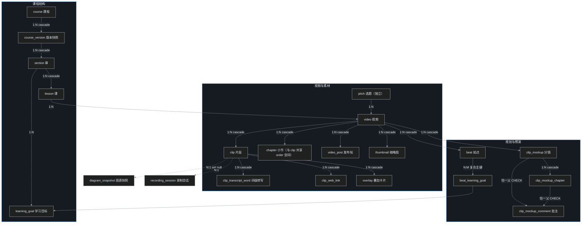
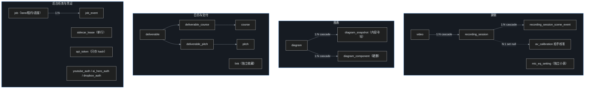

# 拆解 Matt Pocock 的 Course Video Manager：一个人的课程视频工厂

叶扬的楞严咒音视频流水线跑通之后，下一个问题是蒙学系列（三字经、百家姓、千字文，乃至小学语文课文）怎么批量管理。调研现成的解法时翻到了 Matt Pocock 的 course-video-manager（下称 cvm）：一个专门管理「课程视频从规划到发布」全流程的工具，854 颗星，2025 年 7 月建库，调研前一天（2026-10-27）还在推代码。

这篇是对该仓库的完整拆解：架构、目录树、空间占用、产出文件、37 张数据库表、ER 关系、解决的痛点，以及叶扬这条流水线能借什么。数据全部来自 2026-10-28 浅克隆的 `ba61c65`（2026-10-25 的合并提交），文末附逐项出处。

先声明一条边界：**仓库没有挂开源许可证**（GitHub `licenseInfo` 为 null），默认保留所有权利。思想可以借鉴，代码不能照抄。

## 一、作者要解决什么痛点

Matt Pocock 是 TypeScript 教学圈的高产课程作者。一个人持续产出课程视频，瓶颈不在「会不会剪」，而在七件琐事：

1. **真人录制的素材混乱**：麦克风、摄像头、屏幕三路流要同步，音画偏移要拿拍手声校准（clap），录制中丢帧要计数。
2. **课程结构的多版本管理**：一门课的章节结构要反复改，但已发布的版本不能再动——需要「草稿/待审/已发布」的生命周期，还要回答「这一课在新旧版本里是不是同一课」。
3. **剪辑决策挂在转写上**：剪辑点不是拍脑袋定的，是由 Whisper 词级转写驱动的（哪句废话剪掉、哪里停顿）。
4. **规划先行**：先写学习目标，再排拍点（beat），再配分镜（一张静帧＋一句词），最后才录——防止开录了才发现内容不成立。
5. **一鱼多发的文案位**：一个选题要同时备 YouTube 标题、Newsletter 标题、推文、缩略图文案。
6. **让 AI agent 安全地操作领域数据**：Matt 大量用 agent 干活，需要 CLI 契约（Schema Version 不匹配直接 exit 6）、草稿写保护（DRAFT_GUARD 行锁）、只许本地跑的命令（exit 7）。
7. **架构腐化防御**：一个人维护两千多个 TypeScript 文件，靠 19 个守卫脚本把「领域库不许碰文件系统」「文件不许超行数」这类规矩焊死在 CI 里。

一句话：**cvm 管的不是视频，是一个人的课程生产秩序。**

## 二、仓库布局与空间占用

Turborepo + pnpm 的 monorepo，浅克隆落地 **28 MB / 2415 个文件**（GitHub 侧报 18.5 MB），其中 TypeScript/TSX 源文件 2049 个：

| 路径 | 体积 | 作用 |
|---|---|---|
| `apps/local` | 14 MB | 主应用，其中 `app/` 一个目录占 12 MB：React Router 界面、视频编辑器、图表 Playground、发布流、CLI |
| `apps/local/sidecar` | 705 KB | 后台任务进程（Whisper 转写等） |
| `apps/local/recorder-service` | 563 KB | 自研录制服务（套 OBS 剪辑逻辑的适配器） |
| `apps/remote` | 141 KB | Hono RPC，部署在 Vercel，给 CLI 提供远程传输 |
| `packages/core` | 4.8 MB | 领域库：Drizzle schema 与全部 SQL，**禁止碰文件系统/子进程** |
| `packages/overlay-renderer` | 548 KB | 独立 Remotion 渲染器，自带工具链与 Chromium |
| `packages/lucide-icons` | 490 KB | 图标包 |
| `docs/adr` | 1.1 MB 内 | **56 篇架构决策记录**，编号到 0053 |
| `scripts` | 249 KB | 19 个 check-* 守卫脚本 |
| `tests` | 80 KB | 12 个根级守卫测试 |
| `.git` | 5.2 MB | 浅克隆历史 |

目录树（略去 node_modules 与细节文件）：

```
course-video-manager/
├── CLAUDE.md / GLOSSARY.md / CODING_STANDARDS.md   # 给 agent 读的三件套
├── package.json / turbo.json / pnpm-workspace.yaml
├── apps/
│   ├── local/                    # 跑在作者本机的一切
│   │   ├── app/                  # React Router 主应用 + cvm CLI
│   │   ├── recorder-service/     # 录制服务（随 pnpm dev 启停）
│   │   ├── sidecar/              # 后台任务进程
│   │   ├── ffmpeg/               # 自带 ffmpeg
│   │   ├── chrome-extension/     # 浏览器扩展
│   │   ├── stream-deck-forwarder/  # 直播控台按键转发
│   │   └── live-desk/            # 直播桌面
│   └── remote/                   # Hono on Vercel（只有 main 分支部署）
├── packages/
│   ├── core/                     # 领域库：db/ features/ rpc/ services/
│   │   └── db/                   # schema.ts（1581 行）+ 41 个迁移 SQL
│   ├── overlay-renderer/         # Remotion 独立渲染器（shell 调 bin.mjs）
│   └── lucide-icons/
├── docs/
│   ├── adr/                      # 56 篇 ADR
│   ├── agents/prompts/           # 给 agent 的提示词库
│   └── recorder-scorecard/baseline/  # 录制质量记分卡基线
├── frame-examples/               # 渲染帧视觉契约样例
├── plans/backlog/                # 计划文档
├── scripts/                      # 19 个守卫脚本 + 3 个 allowlist JSON
└── tests/                        # 12 个根级守卫测试
```

`packages/core` 的边界由 `lint:boundaries`（dependency-cruiser）强制：凡是需要碰机器的能力（文件、ffmpeg、浏览器）一律从 `apps/local` 注入。这是整个仓库最硬的一条架构红线。

## 三、产出文件

cvm 的产出物分四类：

| 产出 | 形态 | 说明 |
|---|---|---|
| **course.json** | 不可变 JSON release | 发布的课程描述文件；beats、clip_mockups、script 等内部规划物**永不进入** |
| **overlay .mov** | ProRes 4444 透明通道视频 | overlay-renderer 渲染，一张卡片一个文件，时长精确等于卡片本身，zod 校验 props |
| **成品视频** | finished videos 目录 | `cvm course readiness` 检查每课是否已导出 |
| **过程产物** | Kokoro TTS 音频、Whisper 词级转写、缩略图 PNG、Dropbox/Buffer 帖子 JSON、diagram PNG | 分镜试听、剪辑依据、封面、多平台分发 |

存储纪律由 ADR-0040/0041 定死：文件一律存**存储根相对路径**，迁移存储只搬不删原素材。

## 四、数据库：37 张表

Postgres + Drizzle，迁移 additive-only（只增不改）。`schema.ts` 一个文件 1581 行装 30 张表，另有凭证 3 + API token 1 + 后台任务 3，共 **37 张**。按功能域分组：

**① 课程结构（5 张）**

- `course`：课程主实体，不对应磁盘上的任何仓库（ADR-0018）
- `course_version`：版本快照，`commit_state` 限定 draft/pending/published，`has_changes` 回答「这个草稿需不需要发布」
- `section`：章，标题在兄弟节点间唯一
- `lesson`：课，`lineage_id` 跨版本身份＋`previous_version_*_id` 双 ID，`order` 用 double precision 分数索引，`dependencies` 是 text 数组
- `learning_goal`：学习目标，先写目标再备课

**② 视频与素材（8 张）**

- `video`：挂在 lesson 与 pitch 下，`format` CHECK 限定 landscape/short，记录原始素材路径与脚本
- `clip`：片段，`source_start/end_time` 是**clip 相对秒**，`order` 用 varchar COLLATE C 与 chapter 共享序空间，`transcription_status` 驱动转写状态机
- `clip_transcript_word`：词级转写，时间是 clip 内相对秒
- `clip_web_link`、`chapter`、`overlay`（锚 clip 的 at 偏移，可跨 clip）、`thumbnail`（layers jsonb）、`video_post`

**③ 规划与预演（6 张）**

- `pitch`：选题，一鱼多吃的文案位（youtube_title/newsletter_title/tweet）
- `beat`：拍点，可拖拽换 video（FK 刻意 mutable）
- `beat_learning_goal`：复合主键关联表
- `clip_mockup`：分镜＝一张静帧＋一句词，line/audio 按内容 hash 共享；顺次播放就是 Animatic——**没有 Animatic 这张表，那只是播放行为的名字**
- `clip_mockup_chapter`、`clip_mockup_comment`（恰一父 CHECK：要么属于分镜要么属于分镜小节）

**④ 录制（4 张）**

- `recording_session`：三路文件路径、`mic_offset_ms` 默认 150、`frames_lost`、状态机
- `recording_session_scene_event`：录制中的场景切换事件
- `av_calibration`：拍手校准——noise_floor_db、speech_lufs、true_peak_db、claps_found、clap_spread_ms
- `mic_eq_setting`：麦克风三段 EQ

**⑤ 图表（3 张）**：`diagram` → `diagram_snapshot`（content_hash 内容寻址，diagram+hash 唯一）→ `diagram_component`

**⑥ 日历与交付（4 张）**：`deliverable`＋`deliverable_course`＋`deliverable_pitch`＋`link`

**⑦ 后台任务（3 张）**：`job`（lane 车道、params jsonb、depends_on 前置、租约 holder/lease_until、progress）＋`job_event`＋`sidecar_lease`（单行租约表）

**⑧ 凭证（4 张）**：`youtube_auth`、`ai_hero_auth`、`dropbox_auth`、`api_token`（只存 token_hash）

## 五、ER 关系

`schema.ts` 里共 28 条外键，绝大多数 `onDelete: cascade`，少数 `set null`（图表快照、AV 校准这类「挂了不该连坐」的引用）。主干骨架：



辅助系统（录制、图表、交付、后台、凭证）：



读图要点三条：

1. **一切挂在 video 上**。video 是全图度数最高的节点：上接 lesson/pitch，下垂 clip/chapter/beat/mockup/recording/post/thumbnail 七个孩子。
2. **级联删除就是生命周期**。course 一路 cascade 到 clip_transcript_word，删掉草稿版本整棵子树陪葬；而 diagram_snapshot、av_calibration 用 set null——共享资源不连坐。
3. **规划物与发布物物理隔离**。pitch/beat/mockup/script 全部不进 course.json，发布产物只含成品视频＋课程描述。

## 六、建模手法：七个可抄的作业

抛开业务，单看 Postgres/Drizzle 建模，有七个手法值得记录：

1. **UUID 主键＋手动给每个 FK 建索引**（Drizzle 不自动建，源码注释里专门检讨过漏建的 seq-scan 事故）。
2. **软删不统一**：课程结构用 archived 软删＋部分唯一索引，规划物（批注、图表组件）直接硬删——按「值不值得留尸」分级。
3. **double precision 分数索引做排序**，并且 clip 与 chapter **共享一个 order 空间**（小节可以插在片段之间）。
4. **lineageId 双 ID**：行 ID 标识「某版本里的一行」，lineageId 标识「跨版本的同一课」，外部系统只存后者。
5. **CHECK 约束镜像 TS 枚举**（如 video.format 只允许 landscape/short），数据库层兜底应用层。
6. **时间一律相对秒**，渲染时才转帧——与帧率解耦。
7. **内部物永不进发布产物**，用「publish 跳过清单」而不是「发布时过滤」来实现。

## 七、守卫工程：一个人的质量部

cvm 最让叶扬震动的不是功能，是**一个人给自个儿建的质量部**：

- **19 个 check-\* 守卫脚本**：领域库禁文件系统、禁 `__dirname`、文件行数上限（shrink-only allowlist：只许缩不许涨）、前端状态写法、Effect 用法、复杂度上限、后台任务注册表……husky 暂存区跑快集，CI 跑 `--all` 全集。
- **12 个根级守卫测试**：连「CLI 的 Schema Version 握手」「迁移是否 additive-only」都有测试守着。
- **56 篇 ADR**：小到「shorts 的副屏是 1080×1080」，大到「录制服务随 pnpm dev 启停」，全部留痕。agent 干活前先读 ADR，决策不丢。
- **41 个迁移 SQL**：drizzle-kit generate 生成版本化文件，禁用 push，迁移手工执行（ADR-0026）。
- **recorder-scorecard baseline**：录制质量有基线记分卡，回归可测。

这套东西的本质：**把「规矩」从脑子搬进 CI，让 agent 和未来的自己都没法偷懒。**

## 八、叶扬能借什么

对照叶扬的 TTS 流水线（蝉镜双稿取音 → ASR 质检 → ffmpeg 降噪 → hyperframes 视频），按可借程度分三档：

**第一档：直接搬，零成本**

- **渲染器契约**：overlay-renderer 的「独立进程＋zod 校验 props＋shell 调用」与 hyperframes 的用法同构，验证了这条路线的正确性。
- **母带记分卡**：`av_calibration` 的 noise_floor/speech_lufs/true_peak 三件套，叶扬在降噪环节量的就是这些——给每篇成品存一份 sidecar JSON，批量质检一个脚本扫完。
- **秒→帧纪律**：领域层一律相对秒、渲染才转帧，叶扬的 SRT 时间轴已经是这么做的。

**第二档：搬思想不搬形**

- **shrink-only allowlist**：文件/复杂度只许缩不许涨的「棘轮」，适合给流水线脚本用。
- **内容寻址**：diagram_snapshot 按 hash 去重，对应「正音表改了哪些篇要重取音」的新鲜度判定——产物旁记 `hash(src稿 + rules + 音色ID)` 即可，不需要数据库。
- **ADR 习惯**：SOP 文档里已经在做，可以补编号。

**第三档：看得懂但用不上**

- lineageId 版本树、Draft/Pending/Published 生命周期：单篇定版的朗读视频没有多版本诉求。
- 录制服务、Stream Deck、OBS 适配：TTS 直出 wav，无真人录制。
- job 车道/租约/sidecar：串行脚本十分钟跑完的事，不需要任务队列。

至于「要不要上 cvm 那样的数据库」——**不上**。一年级语文全部篇目几十课、几百个文件，文件系统＋一张 manifest 清单（册次/课序/字数/各工序状态）就够；等到「查哪些篇含某破读字」超过一条 grep 的复杂度，先加 SQLite 缓冲层；真出现多人协作、多平台自动发布，cvm 的架构才对得上号。**台账问题不要用课程管理系统解决。**

## 附：调研方法与数据出处

- 仓库：`github.com/mattpocock/course-video-manager`，浅克隆于 2026-10-28，HEAD `ba61c65`（2026-10-25）
- 星数/建库时间/最近推送/许可证：`gh repo view --json`，2026-10-28 查得 854★、2025-07-24 建、2026-10-27 推、licenseInfo null
- 体积：`du -sh` 各目录；文件数 2415 来自 `git ls-files | wc -l`；TS 文件 2049 来自 `git ls-files '*.ts' '*.tsx'`
- 表数 37：`schema.ts` 30（createTable 计数）＋ schema-auth 3 ＋ schema-api-token 1 ＋ schema-jobs 3；外键 28 条来自 `grep "references("`
- ADR 56 篇、check 脚本 19 个、根测试 12 个、迁移 41 个：对应目录 `ls | wc -l`
- 术语与生命周期语义：`GLOSSARY.md`、`CLAUDE.md`、`docs/adr/` 原文
