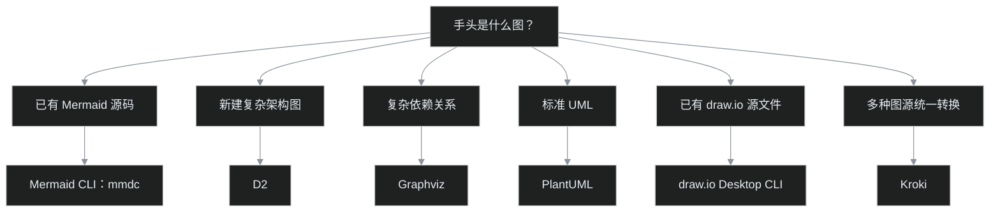

Mermaid 写图很爽：几行文本就是流程图，改起来也不用拖一堆小方框。可一到交付环节，问题就来了——目标平台不渲染 Mermaid，PPT 要插图，公众号要图片，手里只剩一段看起来很聪明、对方却显示不出来的代码。

叶扬为此查了一圈代码制图 CLI。先给结论：**已经有 Mermaid 源码，直接用官方的 `mmdc`；准备重新设计复杂架构图，再看 D2；UML、依赖关系和已有 draw.io 文件，各有各的趁手工具。**

这篇是基于官方文档整理的选型地图，不是六款工具的同机横评。命令和边界做了文档核对，但没有把六款工具全部安装实测一遍——调研是地图，不冒充实测报告。



## 一、已经有 Mermaid，别再换语言

最合适的工具就是 Mermaid 官方 CLI，包名 `@mermaid-js/mermaid-cli`，命令名 `mmdc`。

全局安装：

```bash
npm install -g @mermaid-js/mermaid-cli
```

先把 Markdown 里的 Mermaid 代码保存为 `diagram.mmd`。注意，`.mmd` 文件只放图本身：

```text
flowchart TD
    A["原始需求"] --> B["生成图片"]
```

不要连同外层的 ```` ```mermaid ```` 和结束围栏一起复制进去。源码里已经有暗色 `init` 的，原样保留即可。

导出 SVG：

```bash
mmdc -i diagram.mmd -o diagram.svg
```

导出深色背景、两倍分辨率的 PNG：

```bash
mmdc -i diagram.mmd -o diagram.png -b "#0d1117" -s 2
```

如果源码没有指定主题，也可以显式加上 `-t dark`。`-s 2` 是 Puppeteer 的缩放倍率，适合给高分屏和需要清晰插图的页面留点余量，不是把图里的文字放大两倍。

不想全局安装，可以通过 `npx` 调用。包名和命令名不一样，所以要用 `-p` 指明包：

```bash
npx -y -p @mermaid-js/mermaid-cli mmdc \
  -i diagram.mmd -o diagram.png -s 2
```

`mmdc` 还能直接处理含有 Mermaid 代码块的 Markdown 模板，把图转换成 SVG 文件，再把图片链接写回新的 Markdown：

```bash
mmdc -i article.template.md -o article.md
```

这条命令很适合“整篇文稿统一出图”。原始模板别直接当输出文件覆盖，留下源码，后面改图才有回头路。

还有一个小前提：Mermaid CLI 背后靠 Puppeteer 和 Chromium 渲染，不是纯文本转换器。安装或启动出错时，别只盯着 Mermaid 语法，也要检查 Node.js、浏览器下载和 Puppeteer 配置。

## 二、SVG 和 PNG，不是谁更高级

这两个格式像数据库里的源表和导出快照：一个保留结构，方便继续处理；一个固定成像素，拿到哪里都容易显示。照例戳破这个类比的洞——SVG 不是通用数据库，PNG 也不是只能看一次的快照，这里只借用“源文件”和“交付物”的区别。

| 输出格式 | 更适合的场景 | 要注意什么 |
|---|---|---|
| SVG | 博客、文档站、矢量插图、后续编辑 | 个别平台不接收；字体和外部资源要随发布环境检查 |
| PNG | 公众号、PPT、聊天工具、兼容性优先的交付 | 会固定分辨率，建议按用途导出足够尺寸 |
| PDF | 打印、评审材料、整页交付 | 不一定是文章插图最方便的格式 |

叶扬的默认策略很简单：**源文件留 `.mmd`，网页优先 SVG，平台兼容优先 PNG。** 不要只留下一张 PNG，然后下次改一个字又重新画图。

## 三、另外五款工具，各自解决什么问题

先放一张对比表，避免把所有“文本变图片”的工具都当成 Mermaid 替代品。

| 工具 | 主要输入 | 更擅长的事 | 常见输出 |
|---|---|---|---|
| Mermaid CLI | `.mmd`、含 Mermaid 的 Markdown | 快速把现有 Mermaid 变成文章插图 | SVG、PNG、PDF |
| D2 | `.d2` | 软件架构、容器关系、较复杂的文本制图 | SVG、PNG、PDF、PPTX 等 |
| Graphviz | DOT | 调用关系、依赖图、自动布局 | SVG、PNG、PDF 等 |
| PlantUML | `.puml` 等 | 类图、时序图、用例图等 UML | PNG、SVG 等 |
| draw.io Desktop CLI | `.drawio`，也支持部分其他输入 | 保留已有拖拽设计，批量导出 | SVG、PNG、PDF 等 |
| Kroki CLI | 多种图表源码 | 用统一入口转换不同图表语言 | 取决于图类型与服务端支持 |

### D2：新架构图值得试，旧 Mermaid 不必迁移

D2 是一种现代文本制图语言，节点、容器、连接和样式都能写进源码。官方 CLI 的基本用法很直接：

```bash
d2 diagram.d2 diagram.svg
```

加上 `--watch` 可以在修改源码时自动刷新输出：

```bash
d2 --watch diagram.d2 diagram.svg
```

D2 的优势不是“也能画流程图”，而是面对复杂软件架构时，有更完整的布局、主题和语言工具。已经写好的 Mermaid 没坏，就没必要为了追新全部重写。

### Graphviz：关系一多，让布局引擎干活

Graphviz 更像老牌自动排版发动机。给它节点和边，它负责把关系图摆开：

```bash
dot -Tsvg diagram.dot -o diagram.svg
```

把 `svg` 换成 `png`，就能得到 PNG。它特别适合依赖关系、调用关系和程序生成的图。反过来说，如果只是想画三五个框，DOT 的样式控制未必比 Mermaid 省事。

### PlantUML：UML 需求明确时再用

PlantUML 的强项是 UML 生态。类图、对象关系、用例和时序表达，都有成熟语法。跨平台的基础调用方式是通过 Java：

```bash
java -jar plantuml.jar --format svg --output-dir out diagram.puml
```

PlantUML 的部分图类型和布局会涉及 Graphviz，官方命令行也提供 `--check-graphviz` 供检查。别把它简化成“所有图都必须另装 Graphviz”，也别等报错以后才想起布局依赖——按实际图类型确认。

### draw.io CLI：已有设计稿，直接批量导出

如果图源本来就是 `.drawio`，第一选择通常不是重写成 Mermaid，而是让 draw.io Desktop 自己导出：

```bash
drawio -x -f svg -o diagram.svg diagram.drawio
```

这条路线保留了原来的位置、图层和手工排版。它更像设计软件的批处理出口，而不是另一套文本制图语言。Windows 上如果找不到 `drawio` 命令，先确认桌面版安装位置和 PATH，不要急着怀疑导出参数。

### Kroki：统一入口很方便，图源去向更重要

Kroki 把多种制图库收进统一 API，Kroki CLI 则负责把源码交给服务端转换：

```bash
kroki convert diagram.dot --out-file diagram.svg
```

它适合团队已经混用 Mermaid、PlantUML、Graphviz 等格式，又不想再维护一排不同命令的场景。

但这里有个不能省掉的边界：**Kroki CLI 默认使用演示服务器，图源会发往所配置的 endpoint。** 内部架构、客户信息和未公开业务图，不该随手丢给公共服务。官方支持 Docker、Podman 和手动部署，私有资料应使用可信的自托管实例，再把 CLI 的 endpoint 指向该实例。

## 四、真正容易翻车的地方

**第一，代码块能预览，不等于导出链路能跑通。** 编辑器里的 Mermaid 版本、CLI 使用的版本和最终平台可能不同。正式批量处理前，先拿一张最复杂的图做全链路验收。

**第二，中文要实际打开检查。** 字体缺失、回退字体变化和平台重新压缩，都可能让“命令执行成功”与“图片能交付”变成两回事。

**第三，暗色图别随便配透明底。** 深色页面看着漂亮，换到白色页面可能连字都找不着。交付环境不确定时，显式背景通常更稳。

**第四，私有源码先问发给谁。** 本地 `mmdc`、D2、Graphviz 和 PlantUML 与远程渲染服务，不是同一条数据边界。统一入口再优雅，也不能把这一问省掉。

**第五，最后要看发布后的图。** 导出成功只说明文件生成了；插图是否清晰、链接是否有效、深色背景是否协调，要到最终页面验收。

## 五、怎么选，保持简单就好

叶扬会把工具清单压成这条顺序：

1. 现有 Mermaid 要插图：先装 `mmdc`，同时保留 `.mmd` 源文件。
2. 新建复杂架构图：试 D2，不为了换工具而换工具。
3. 自动生成依赖关系：选 Graphviz。
4. 明确需要 UML：选 PlantUML。
5. 已有 `.drawio`：直接用 draw.io Desktop CLI 导出。
6. 多语言统一转换：考虑 Kroki，自托管边界先于命令便利。

工具越多，不一定越自动化。对当前这批 Mermaid 图，最短路径其实只有一条：**提取源码，运行 `mmdc`，检查图片，再插入目标平台。** 剩下的工具，等对应问题真的出现再请上场。

## 官方资料

- [Mermaid CLI](https://github.com/mermaid-js/mermaid-cli)
- [D2](https://github.com/terrastruct/d2)
- [Graphviz 命令行](https://graphviz.org/doc/info/command.html)
- [PlantUML 命令行](https://plantuml.com/command-line)
- [draw.io Desktop](https://github.com/jgraph/drawio-desktop)
- [Kroki CLI](https://github.com/yuzutech/kroki-cli) 与 [Kroki 本地部署](https://docs.kroki.io/kroki/setup/install/)
