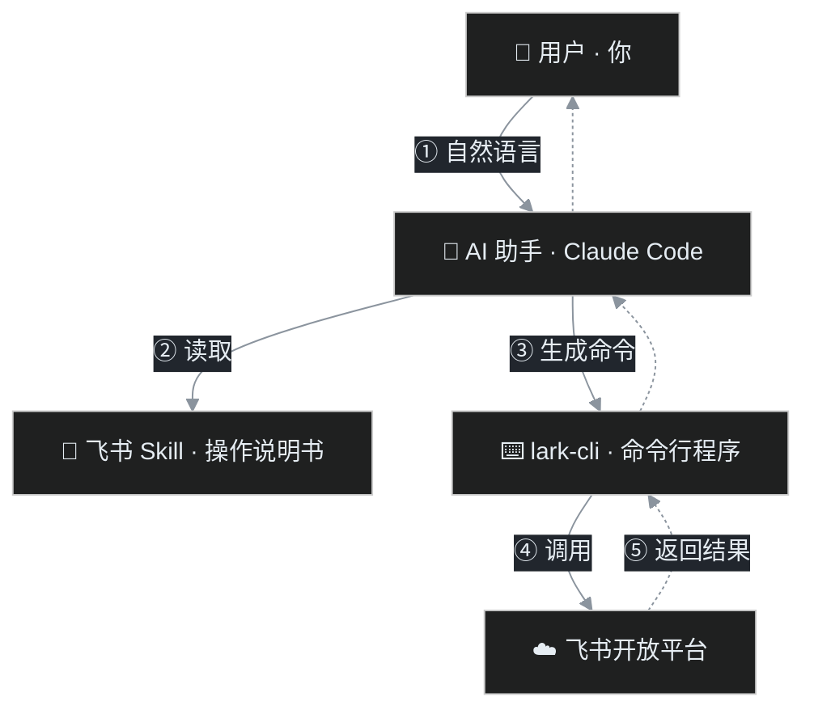

> 💡 **一句话：**飞书 CLI（lark-cli）是一个把飞书功能变成终端命令的**程序**；飞书 Skill 是教 AI 助手如何正确使用这个程序的**操作说明书**。一个负责"动手"，一个负责"指导"。
> 本文写给已在用 AI 助手（如 Claude Code）、希望用命令行或自然语言操作飞书的人。读完你能说清两者各是什么、如何配合、能做什么，并跑通第一条命令。

# 一张图看懂：它们在同一条链路里

当你对 AI 助手说一句话，最终是怎样在飞书里落地的？下面这张分层图是全文的核心心智模型。



注意 Skill 与 lark-cli 的**关系不是串联**：AI 助手一边参考 Skill（决定"该怎么做"），一边调用 lark-cli（真正"去做"）。Skill 本身不直接连飞书，它只服务于 AI。

# 飞书 CLI（lark-cli）是什么

lark-cli 是一个安装在你电脑上的命令行程序。它把**飞书开放平台**成千上万的 HTTP 接口，包装成一条条人能读、能补全的终端命令。你不用手写 HTTP 请求、不用手动管理令牌，也能收发消息、读写文档、操作日历、拉取会议纪要……

当前本机版本为 **1.0.96**，覆盖即时通讯、日历、文档、多维表格、会议、审批、OKR、云空间等 **23 个功能域**。

## 三种命令风格：从"最省事"到"最底层"

同一个目标，lark-cli 提供三种由高到低的写法，按优先级选择：

| 风格 | 含义与示例 | 什么时候用 |
|-|-|-|
| **① 快捷指令  <br/>+shortcut** | 封装好的"一件事"，最省事。  <br/>`lark-cli calendar +agenda` | 有匹配的 shortcut 时**优先**用它，参数少、意图明确。 |
| **② 类型化命令** | 对应某一个具体接口，结构清晰。  <br/>`lark-cli mail user_mailbox.messages list --user-mailbox-id me` | 没有 shortcut、或需要精确控制某个接口的参数时。 |
| **③ 原始接口** | 逃生舱，按 HTTP 路径调用任意端点。  <br/>`lark-cli api GET /open-apis/calendar/v4/calendars` | 前两者都没覆盖某个接口时的最后手段。 |

## 安全分级与趁手的辅助命令

每条命令在帮助里都会标明风险等级，让"读"和"写"一目了然：

- **read**：只读，安全，例如查询日程、读取文档；
- **write**：会产生改动，例如发消息、改文档；
- **high-risk-write**：高风险写操作，必须在你确认后加 `--yes` 才会真正执行。

另外几个对人和 AI 都很友好的辅助能力：

| 命令 / 参数 | 作用 |
|-|-|
| `lark-cli schema <方法>` | 查看某接口需要的参数、类型和权限范围，调用前先摸清契约。 |
| `--dry-run` | 只预览将要发出的请求，**不真正执行**，写操作前强烈建议先跑一次。 |
| `--jq <表达式>` | 在命令端直接过滤 JSON 输出，只取你关心的字段。 |
| `lark-cli doctor` | 一键体检：配置、登录态、连通性是否正常。 |
| `lark-cli auth` | 管理登录授权与身份。 |

# 飞书 Skill 是什么

Skill **不是程序，它自己不会执行任何操作**。它是一份给 AI 助手阅读的"操作说明书"：用自然语言告诉 AI：遇到什么场景、该按什么顺序、调用哪条 lark-cli 命令、注意什么参数和坑、什么情况要停下来找用户确认。

为什么需要它？因为飞书接口数量庞大、命令层级深。如果让 AI 凭印象自由发挥，容易调错命令、漏掉确认或踩权限的坑。Skill 把资深使用者的经验固化成**路由规则和参考文档**，让 AI 的每次操作都有据可依。

## 一个 Skill 长什么样

每个 skill 就是一个文件夹，核心是一份 `SKILL.md`，外加按需查阅的 `references/` 参考：

- `SKILL.md`：写清"什么时候该用我"、场景如何路由、命令的总体用法；
- `references/`：把每种具体操作拆成独立参考文件，AI 进入对应阶段才读取，避免一上来就塞进一大堆信息。

本目录里 **lark-cli 自身也内置了同一份 skill 内容**，可用 `lark-cli skills list` 和 `lark-cli skills read <名字>` 直接查看。

## 28 个 Skill 全景

当前共安装 **28 个**飞书 skill，下表按职能分组（省略统一的 `lark-` 前缀）：

| 职能分组 | 包含 Skill |
|-|-|
| 💬 沟通协作 | im、mail |
| 📄 文档与云盘 | doc、sheets、slides、whiteboard、markdown、drive、wiki |
| 📊 多维表格 | base |
| 📅 日历与会议 | calendar、meeting、minutes、note、vc、vc-agent、workflow-meeting-summary |
| ✅ 任务 / 审批 / OKR | task、approval、okr |
| 🕐 考勤 | attendance |
| 👥 通讯录 | contact |
| 🛠️ 平台、自动化与开发 | apps、event、openapi-explorer、skill-maker、shared、workflow-standup-report |

# 两者如何配合：一次请求的完整旅程

以"帮我看看今天的日程"为例，把链路拆成可观察的步骤：

1. 你对 AI 助手说出**意图**（自然语言，无需记命令）；
2. AI 判断这属于日历场景，**读取 `lark-calendar` skill**；
3. 按 skill 的路由，AI 选定快捷指令 `calendar +agenda`；
4. AI **调用 lark-cli**，CLI 负责带上授权、向飞书开放平台发起请求；
5. 飞书返回数据给 lark-cli，lark-cli 把结构化结果交回 AI；
6. AI 把结果组织成你容易读的回答。

> 💡 **分工的价值：**lark-cli 保证**确定性、权限和安全分级**（每一步是否危险、要不要确认，都由它把关）；skill 保证 AI **不瞎调、按最佳实践来**。两者叠加，才让"一句话操作飞书"既灵活又可靠。

# 上手：最小可用路径

1. **确认已安装**，查看版本：

```bash
lark-cli --version
```

1. **体检并登录**。先跑 doctor，若提示未授权，按提示完成授权：

```bash
lark-cli doctor
lark-cli auth
```

1. **跑通第一条只读命令**，例如查看今天的日程：

```bash
lark-cli calendar +agenda
```

1. **在写操作前，先用 `--dry-run` 预览**，确认请求内容无误后再真正执行：

```bash
lark-cli im ... --dry-run
```

更自然的方式是：直接在 AI 助手里用一句话说出目标，让它按对应 skill 替你完成上述命令，你只在写操作或高风险操作时做一次确认。

# 边界与注意

- **写操作需要你确认**；标记为 high-risk-write 的命令还必须显式加 `--yes`，AI 不会擅自执行。
- **权限范围（scope）**：能调用哪些接口取决于登录时授予的权限；若某命令报 scope 错误，需要补充授权。
- **Skill 只指导、不执行**：真正对飞书产生影响的永远是 lark-cli 发出的请求。
- **可以自己造 skill**：用 `lark-skill-maker` 能把你重复使用的流程沉淀成新的自定义 skill。
- **想更深入**：复杂应用搭建看 `lark-apps`，实时事件监听看 `lark-event`，未被封装的接口看 `lark-openapi-explorer`。

> 🎯 **记住这一句就够了：**飞书 CLI 是"手"，飞书 Skill 是"给 AI 看的地图"。手由程序驱动、按权限安全地操作飞书；地图让 AI 每次都走对路。
