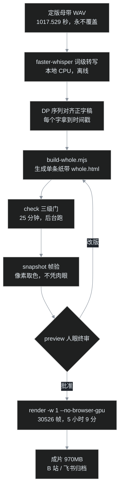

## 先交底

叶扬上一个项目（克隆音色念完 3601 字楞严咒）的终点，是这条流水线的起点：一条 16 分 57 秒的定版母带 WAV。这次要做的是把它变成视频——不是套模板那种「佛像背景＋滚动字幕」，而是仿明清大藏经的**梵筴经折装**：一整条物理连续的纸带，竖排右起，栏线、折痕、折页堆一应俱全，念到哪一句，哪一句整句转朱砂红，读完沉成深墨；封面不是一个独立片头，而是长在纸带最右端的书框，从第一帧就是完整的一部经。

最终成片 970MB、1920×1080@30fps，从头到尾一镜到底，零剪辑点。全部画面是一个 HTML 文件，用 HyperFrames 逐帧求解渲染。

这篇记录从拿到 WAV 到成片发布的完整工艺：各阶段实测耗时、踩过的坑、以及为什么「时间轴不许手写帧位」是整条流水线的第一红线。



## 第一红线：时间轴只能生成，不能手写

整条流水线的地基是一句话：**时间轴必须由音频的 ASR 时间戳生成，任何人不许手写帧位。**

为什么值得立成红线？因为音频是会改的。这个项目里母带重录过两轮（改读音、做降噪），每次重录，每个字在第几秒全部漂移。如果版式里有一个手写的「第 8 秒翻页」，重录一次就报废一处，而且报废得无声无息——画面还在动，只是和声音慢慢错开，等肉眼发现时已经错版了半分钟。

所以架构是：faster-whisper 本地离线转写出**词级时间戳**，再用一个 DP 序列对齐（带繁简字形归一）把每个字的时间钉到正字稿的对应字上，产出两类数据——576 个句组（整句高亮用）和 3544 个滚动关键点（纸带位移用）。构建脚本读这两份数据生成 HTML 里上万条 GSAP tween。音频换了？重跑 ASR，重跑构建，三分钟出新时间轴，版式一行不用动。

两个数据层的坑，都是出过事故才立下的：

- **关键点时间必须严格递增。** ASR 偶尔给相邻字相同的时间戳，两个同刻 tween 会互相覆盖，画面抽搐。修法很土但有效：同刻自动加 0.012 秒微扰。
- **切字用码点，不用下标。** 经文里有「𤙖」这类生僻字，占两个 UTF-16 单元。按 `length` 切字，一切到这里全错位。一律 `[...s]`。

## 版式：一条纸带，没有章节

定稿版式是「单纸带」架构：3601 字排成 237 列竖排经文，装在同一条 17424px 宽的纸带上，外加右端 360px 的书框。纸带随诵读匀速向右展开，当前诵列恒定在屏中偏右的位置；念到预设的「停列」，纸带停住，最后十几列在静止的整页上读完——开头书框贴屏右、结尾尾经名靠屏左，首尾镜像。

这条架构是五轮改版磨出来的，每一轮都是用户盯着 preview 审出来的意见，记录两个最有代表性的：

**「封面和后面分两段，要连成一个整体。」** 原方案是独立封面页，1.75 秒滑出、正卷淡入。用户一句话否了。改版后书名八个大字直接写在纸带最右端的双线书框里，和正文共用同一张纸的纹理，从第零帧就是满版整体。这个改动的连锁反应很典型：书框占掉 360px 宽度，起滚列从第 12 列提前到第 7 列，开场静止期从 34 秒缩到 15 秒——版式常量在构建器顶部列成一张表，改一处、重跑、构建器里的几何恒等式自检（静页与起滚必须零回拉衔接、书框右缘必须落在 1896px）不一致就直接 throw 报错，不让带病构建。

**「两会之间不要空一行。」** 经文分五会，原方案会间留一整列空白当「翻页感」。用户要求上会末列直接换列接下会。删掉四根素列后，列总数 241 变 237，停列重算，但尾停时刻恰好不变——几何是反解出来的，不是调出来的。

GSAP 侧的纪律也记一笔：tween 只用 fromTo，初态写死在 CSS；零时长的 set 压不住仍 active 的同属性 tween（seek 时 set 已经不是 active 态）；clip 元素上不动 display。这些都是 HyperFrames 契约层面的硬约束，check 会抓，但抓之前先浪费一次 25 分钟。

## 验收：check 过了不算过，取色器说了算

HyperFrames 自带 check（契约检查）和 snapshot（抽帧）。这个项目的验收纪律是三层：

1. **check 必须 0 error。** 本片规模下 check 要跑 25 分钟——瓶颈是 599 个 craft 采样点逐点 seek 一条大时间轴。所以 check 一律后台跑，前台 5 分钟超时一定会误杀。
2. **snapshot 关键帧逐帧看。** 开场满版、起滚瞬间、四个会界、尾页定格，一个不能少。
3. **颜色用取色器验，不用肉眼。** 这条是真踩出来的：朱红句旁边的深墨字，肉眼会看成红棕色；contact sheet 缩略图还有偏色。最后写了个小工具，对 PNG 指定坐标邻域报「最红墨迹」和「最暗墨迹」的 RGB——朱红 rgb(157,41,51)、深墨 rgb(58,48,36)、淡褐 rgb(125,112,93)，数字对了才算过。

一句话：**check 管「程序正确」，帧验管「看着对」，两者不能互相替代。**

## 渲染：5 小时 9 分，和它的三连坑

30526 帧（1017.529 秒 × 30fps），最终命令：

```bash
npx --yes hyperframes@0.8.195 render -q delivery -w 1 --no-browser-gpu -o renders/lengyanzhou-yeyang-delivery.mp4
```

这个命令里的每个参数，都是一次失败换来的。

**坑一：render 和常驻 preview 抢浏览器。** 第一次开跑卡在 "Browser:cache" 十八分钟，零个 chrome 进程——常驻的 preview 服务占着浏览器，render 的准备工作在死等。排查还发现 TaskStop 只杀 shell 不杀进程树，必须按 PID 精确 taskkill；而且不能用 `/IM chrome.exe` 无差别杀（会误杀用户自己的浏览器，权限系统也会拦），要用 PowerShell 按命令行特征匹配出渲染专用的 headless 进程。**教训：render 前先停 preview。**

**坑二：多 worker 必落盘。** 想开 4 个 worker 加速，结果多 worker 模式是每帧存图再编码，30526 帧要 43GB 临时空间，磁盘不够，第 9 帧就死了。只有 `-w 1` 是流式直进编码器、不落盘。**磁盘小的机器，单 worker 是唯一解。**

**坑三：核显硬件加速会挂。** 单 worker 默认走硬件 GPU，跑到第 1400 帧（46 秒处）编码器挂起，14 分钟无心跳被判死。加 `--no-browser-gpu` 换 SwiftShader 软件光栅——纯 2D DOM 场景根本不吃 GPU，软渲反而又稳又快，稳态 1.6 到 1.8 帧每秒。

最终墙钟 5 小时 9 分：帧捕获 306 分钟、音频处理 101 秒、合成封装半分钟。长任务用每 25 分钟一次的定时检查盯帧号推进，比盯着屏幕强。

## 副产品：一张静帧封面，两个 ffmpeg 坑

整片之外还做了一条「封面试听版」：一张 HTML 画的宣纸封面（竖排大字＋朱印，用 puppeteer 借系统 Edge 无头截图成 PNG），和母带合成静帧视频。两个坑值得单独记：

**静帧视频用 1fps，别用 30fps。** 第一版按惯例写了 30fps，静态画面下编码器空转三万帧，速度 0.37 倍，预估 46 分钟。改成 1fps 后只编 1018 帧，5.2 倍速，3 分 17 秒完事，画质零损失，平台兼容无问题。

**循环图片输入别信 `-shortest`。** 这是 ffmpeg 的已知行为：`-loop 1` 的图片流配上 `-shortest`，会在音频结束后多放 60 秒空画面。必须显式 `-t 1017.529` 把时长钉死。

顺手还做了一版响度规整：原母带 -15.9 LUFS 偏安静，用 loudnorm 两遍法（先测量、再线性归一）提到 -14.05 LUFS、真峰值控制在 -1.5dB，因为音频动态极小，等于纯拧音量不压动态。已有的 mp4 用流复制换音轨，视频流零重编码。教训是 `alimiter` 对这种稀疏单样本尖峰限不住，别拿它兜底。

## 发布：一次合规小插曲

B 站投稿走 biliup 命令行，970MB 传了 173 秒。但整片上传后被审核「退回仅自见」——宗教内容在平台侧过不了审。应对不是硬刚，而是做了一条**去宗教化的封面试听稿**：标题只写「朗读试听」，简介留空，标签只挂一个中性的「朗读」，封面用宣纸书框图——音频内容不变，门面全部去敏。这条进了正常审核流程。

音频和字幕另走飞书归档：云空间根目录建文档，WAV 以内嵌播放器挂载，SRT 字幕作附件，以后多端试听、取字幕都在一处。命令行工具（lark-cli）的一个小坑：上传文件必须在当前工作目录白名单内，改名副本放项目临时目录、传完即删。

## 翻车急诊室

- **check 输出空 JSON 直接死** → npx 缓存并发抢锁或版本漂移；hyperframes 命令固定显式版本号，且任何时刻只跑一个。
- **render 卡 "Browser:cache" 无浏览器进程** → 常驻 preview 在抢，按 PID 杀干净再跑。
- **render 报需要 43GB 磁盘** → 多 worker 落盘模式，改 `-w 1`。
- **render 中途无心跳** → 核显编码挂起，加 `--no-browser-gpu`。
- **静帧视频多出一分钟黑屏** → `-shortest` 对循环图失效，显式 `-t`。
- **改完版式首尾对不齐** → 别绕过构建器的几何恒等式自检，先改常量表再重建。
- **颜色看着不对** → 别信肉眼，上取色器。
- **稿件被退回** → 内容审核问题，不是工具问题；做去敏门面稿。

## 完工验收清单

1. 时间轴全部由 ASR 生成，零手写帧位；画面文字全部出自正字稿；
2. 构建器几何自检通过，check 零 error；
3. 开场、起滚、会界、定格四类关键帧全部取色核验；
4. 人眼 preview 终审批准后才 render；
5. render 前三件事：停 preview、单 worker、软件光栅；
6. 成片 ffprobe 核对时长、帧率、音轨；母带与成片另存不覆盖原件；
7. 外发稿件标题、简介、标签逐字过一遍合规。

## 工具清单

| 环节 | 工具 | 备注 |
|---|---|---|
| 转写对齐 | faster-whisper＋自写 DP 对齐 | 本地 CPU 离线，词级时间戳 |
| 版式构建 | Node 构建脚本生成单条 HTML | 常量表驱动，恒等式自检 |
| 渲染 | HyperFrames（显式版本锁 0.8.195） | check / snapshot / render 三件套 |
| 像素验收 | sharp 取色小工具 | 报邻域最红/最暗墨迹 RGB |
| 封面截图 | puppeteer-core 借系统 Edge | 无头 1920×1080 |
| 合成响度 | ffmpeg | 静帧 1fps＋显式 -t；loudnorm 两遍法 |
| B 站投稿 | biliup | 直传无水印 |
| 飞书归档 | lark-cli | 音频内嵌播放器＋附件 |

整条链路的成本结构很有意思：转写、对齐、构建都是分钟级，check 是半小时级，render 是半天级——**越接近像素，时间越贵**。所以工艺的核心策略是把一切错误尽量往左推：让构建器自检拦截几何错误，让 check 拦截契约错误，让取色器拦截颜色错误，把 5 小时的 render 留给「真的没问题了」的那一刻。
