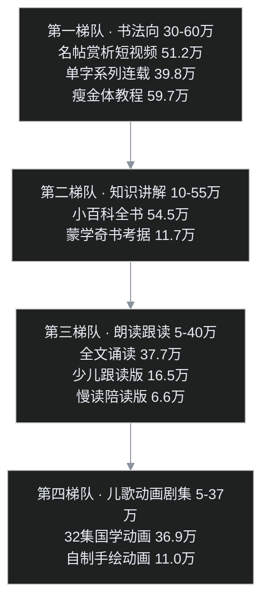

## 先交底

叶扬的「经典诵读」生产线跑完了第一个大活（3601 字楞严咒的经折装视频），下一站是蒙学三百千——千字文打头。开工之前先回答一个问题：**千字文的视频，观众到底爱看什么形态？**

凭印象答这题必翻车，所以直接拉数据：2026 年 10 月 27 日，用 B 站搜索 API 按播放量排序，跑了「千字文」「千字文 唱读／书法／动画／全文朗读／瘦金体／赵孟頫／儿歌／跟读」加「三字经 唱读」「弟子规 全文朗读」两个对照关键词，去重后 **189 条有效样本**。原始 JSON 留档在工程目录，本文所有播放数字都出自这份样本。

结论先行：**千字文视频里最能打的不是"读"，而是"字"——书法向三个细分形态包揽播放榜前列；朗读跟读类有稳定刚需盘但天花板约 20 到 40 万；而同一个 UP 主的同款朗读视频，三字经 150 万播放、千字文只有 19.6 万——这两本书根本不是一个市场。**

## 形态全景：四个梯队

### 第一梯队：书法向，30–60 万，最大赢家

样本里播放最高的千字文相关视频，是墨品书法网的「价值 100 个亿的宋徽宗草书《千字文》」——**51.2 万播放，时长只有 1 分 06 秒**：名帖高清大图＋故事化文案＋BGM，典型的文化短视频配方。

紧跟其后的是两种更轻的形态：

- **单字系列连载**：UP 主「飛絮飄零」把赵孟頫千字文拆成「15 秒一字」的短条，一条一个单字——道、盈、律、民——最高一条 39.8 万，整个系列成矩阵滚动。瘦金体版本同样成立：明月瘦金书法工作室的「瘦金体千字文～岁」21 秒拿了 24.4 万。
- **长教程收藏盘**：瘦金体硬笔千字文分 P 教程 59.7 万；陈忠建书法学堂的智永楷书千字文讲解 36.6 万——注意这条 483 分钟，硬笔规范字千字文 62 集合集 18.9 万。这类视频不靠完播率，靠「收藏了等于学了」的刚需。

**瘦金体是千字文的流量密码**：宋徽宗这个 IP 叠加字形的颜值正义，赏析、单字、教程三个形态全部通吃，样本里带「瘦金体」关键词的条目密度远超其他书体。

### 第二梯队：知识区讲解，10–55 万，增长最快

- 辉叔日志「千字文——古人留给我们的小百科全书」，6 分 16 秒，2026 年 6 月发布，**54.5 万**；
- 盗圣「《千字文》凭什么是千古第一蒙学奇书」，8 分 18 秒，**11.7 万**。

知识区标准配方：悬念式标题＋密集知识点＋配音配图，5 到 8 分钟。千字文天生有料——周兴嗣一夜白头奉敕集字、一千字无一重复、从天文地理到修身处世的结构密度——都是现成的选题弹药。

### 第三梯队：朗读跟读，5–40 万，刚需盘但天花板明确

- 诵读客「诵读《千字文》」10 分 45 秒，**37.7 万**；
- 小小一探花「千字文全文朗读」10 分 38 秒，**19.6 万**；
- 俞文课堂「千字文（少儿跟读版）」18 分钟，**16.5 万**；
- 知困习之「全文朗读慢读版」，标题直接写「10 分钟，方便孩子跟着朗读」，**6.6 万**。

形态高度一致：大字＋拼音或字幕＋配图，横排为主。受众是家长和学生，需求真实、年年有人搜，但播放量级就这样了——它是工具，不是内容消费。

### 第四梯队：儿歌动画剧集，5–37 万，偏低龄

「国学动画《千字文》32 集全」36.9 万、「一次学透三百千」20 集精讲 12.1 万、「耗时二年制作的阅读启蒙动画」11.0 万、儿歌吟唱版 3.5 万。投入产出比最差的一条路——动画制作成本最高，播放并不碾压真人朗读。

## 三个关键判断

**判断一：千字文比三字经冷一个量级，别复制三字经的打法。**

最有力的证据是一组天然对照实验：同一个 UP 主（小小一探花）、同一形态（全文朗读＋字幕）、同一系列「国学启蒙」——三字经 150.2 万，千字文 19.6 万，**差 7.7 倍**。原因不难想：三字经有故事有韵律，弟子规有行为规范，而千字文难字多、无情节，启蒙场景里家长的首选永远是三百千里的前两个。做千字文，受众画像就不是「给娃磨耳朵的家长」，而是对传统文化本身有兴趣的成年观众。

**判断二：看千字文的人，一半是冲着"字"来的。**

书法向（赏析＋单字＋教程）合计播放量碾压朗读向。这对做「古籍版式视频」的人是好消息：竖排、栏线、折页、墨色——经折装形态本质上是书法审美的视频化，离字帖体验比离字幕视频更近。标签挂「书法／古籍」比挂「启蒙」更接近真实受众。

**判断三：「一句一屏」的短条连载形态已被验证成立。**

15 秒一字能跑出 39.8 万，说明超短连载在千字文这个题材上玩得转。千字文四字一句、250 句无重字，天然适合切成「一句一屏」的 9:16 竖屏短条——朗读音频、大字、拼音、墨色版式，一条就是一句。正片做一次，切片收 60 条。

## 落地路线：三个形态怎么排

| 候选形态 | 样本里的量级 | 评估 |
|---|---|---|
| 经折装竖排朗读正片（楞严同款工艺换文本） | 10–40 万区间 | **成本最低、差异化最强**：全网没有「整卷千字文逐字展读」；千字文约 1000 字，成片 4–5 分钟，渲染量只有楞严的 1/4 |
| 9:16 竖屏「一句一屏」切片 | 单条数万至数十万 | 从正片工程派生，一次构建多次收割，覆盖抖音／视频号／B 站竖屏 |
| 知识讲解短片（5–8 分钟口播稿） | 50 万潜力 | 天花板最高，但要单独立项写稿，是另一条生产线 |
| 书法教程 | — | 不做：需要真书法功底，赛道已被陈忠建等占满 |

顺序建议：先做经折装正片（工程复用度最高），竖屏切片紧随其后，知识讲解稿看精力再说。**定位避开启蒙赛道，主打「书法审美＋古籍版式」的成年文化受众。**

## 方法论一句

这次调研的全部成本是半小时加一个 20 行的 Python 脚本——搜索 API 按播放量拉榜、去重、排序，比「我觉得观众喜欢」可靠得多。做内容选型之前先拉一遍榜，这个习惯本身比这次调研的结论更值钱。
